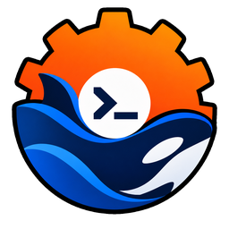

# rdsh — `dsh` を速く・安全に起動する Rust 製ランチャー

[](https://github.com/jimoto-no-llm/rustdsh/actions/workflows/ci.yml)
[](https://github.com/jimoto-no-llm/rustdsh/actions/workflows/dashboard.yml)
[](https://github.com/jimoto-no-llm/rustdsh/actions/workflows/docs.yml)
[](https://github.com/jimoto-no-llm/rustdsh/releases)
[](LICENSE)
[](https://www.rust-lang.org/)

[English](README.md)

独立したコミュニティプロジェクトです。DeepSeek や DeepSeek Harness の公式ではありません。

`rdsh` は、[DeepSeek Harness (dsh)](https://github.com/deepseek-ai/deepseek-harness) を高速かつ安全に利用するための Rust 製ランチャーです。
日常的によく使う処理（トークン計算、検索、セッション管理など）をネイティブ化し、エージェントの会話やモデル実行は本家の `dsh` へそのまま透過的に委譲します。今お使いの引数やオプションはそのまま動きます。

## rdsh を選ぶ理由

- ⚡ **超高速・省メモリ起動**: 起動時間は約0.9ms、メモリ消費は約2.9MB。Node.js を立ち上げる本家 `dsh`（約88ms / 約66MB）と比較して圧倒的に軽量です。
- 🔄 **完全な互換性（Drop-in Replacement）**: `rdsh` 独自のサブコマンド以外は本家 `dsh` にそのまま渡すため、既存のスクリプトや使い慣れたオプションがそのまま動作します。
- 🛠 **便利な高速ネイティブコマンド**: トークン見積り、並列コード検索、セッション一覧・圧縮、環境診断（`doctor`）などを Node.js なしで瞬時に実行できます。
- 🛡 **安全設計**: 読み取り系コマンドは元ファイルを一切書き換えず、認証情報の無断外部送信も行いません。Linux 環境では、エージェントツールを明示的に共有したファイルだけに限定できます。

## 目次

- [クイックスタート](#クイックスタート)
- [動作環境](#動作環境)
- [インストール](#インストール)
- [使い方](#使い方)
  - [`dsh` 互換での実行](#dsh-互換での実行)
  - [高速ネイティブコマンド](#高速ネイティブコマンド)
  - [認証情報のセットアップ](#認証情報のセットアップ-rdsh-auth)
  - [エージェント実行の安全な隔離](#エージェント実行の安全な隔離)
  - [フック監視](#フック監視-rdsh-guard)
- [Web UI とダッシュボード](#web-ui-とダッシュボード)
- [Smart-DSH との併用](#smart-dsh-との併用)
- [実測ベンチマーク](#実測ベンチマーク)
- [安全設計](#安全設計)
- [よくある質問](#よくある質問)
- [資料](#資料)
- [コミュニティ](#コミュニティ)
- [謝辞](#謝辞)
- [ライセンス](#ライセンス)

## クイックスタート

### 1. インストール（ビルド済みバイナリ）

**Linux / macOS / WSL**:

```sh
curl -fsSL https://github.com/jimoto-no-llm/rustdsh/releases/latest/download/install.sh | bash -s -- --from-release
```

**Windows (PowerShell)**:

```powershell
$f = Join-Path $env:TEMP 'rdsh-install.ps1'
Invoke-WebRequest -Uri https://github.com/jimoto-no-llm/rustdsh/releases/latest/download/install.ps1 -OutFile $f -UseBasicParsing
& $f -FromRelease
```

### 2. 環境確認 & 初期セットアップ

```sh
rdsh --version && rdsh doctor   # 導入と本家 dsh の確認
rdsh setup                      # 対話式セットアップ（または rdsh setup --web でブラウザから設定）
```

※ Codex CLI（ChatGPT OAuth）や opencode のログイン情報がある場合、`rdsh auth --import --provider openai-codex` で簡単に取り込めます。

### 3. 会話を開始する

```sh
rdsh tui                        # TUI プロファイルで起動
# または
rdsh --profile web              # Web プロファイルで起動
```

## 動作環境

| 項目 | 内容 |
| --- | --- |
| OS | Linux、macOS、WSL、Windows（ネイティブ） |
| DSH 本体 | エージェントとの会話実行に必要です（トークン計算や検索などの独立ツールは単体で動作します） |
| Rust | ビルド済みバイナリを利用する場合は不要。ソースからビルドする場合のみ 1.85 以上 |
| 任意 | [Node.js ダッシュボード](dashboard/README.md) には Node.js 22 以上、`search-web` には SearXNG が必要 |

## インストール

### ソースからのビルドと高度なオプション

**Linux / macOS / WSL**:

```sh
git clone https://github.com/jimoto-no-llm/rustdsh.git
cd rustdsh
./install.sh                 # ビルドして ~/.local/bin/rdsh にインストール
./install.sh --as-dsh        # `dsh` コマンド名でも使えるように置き換え（元は dsh-orig に退避）
./install.sh --restore       # 置き換えを元に戻す
./install.sh --prefix=DIR    # インストール先を変更（既定: ~/.local/bin）
```

**Windows (PowerShell)**:

```powershell
git clone https://github.com/jimoto-no-llm/rustdsh.git
cd rustdsh
.\install.ps1              # ビルドして %LOCALAPPDATA%\rdsh\bin にインストール
.\install.ps1 -AsDsh       # `dsh` コマンド名でも使えるように置き換え
.\install.ps1 -Restore     # 置き換えを元に戻す
.\install.ps1 -Wsl         # WSL 側にも連動してインストール
```

| OS | スクリプト | 備考 |
| --- | --- | --- |
| Linux / macOS | `./install.sh` | cargo か curl が必要です（rustup がない場合は自動案内されます）。 |
| WSL | ディストロ内で `./install.sh` | WSL を自動検出します。Windows 側と併用する場合は `install.ps1 -Wsl` も利用可能です。 |
| Windows（ネイティブ） | `.\install.ps1` | Rust および MSVC ビルドツールが必要です（`winget install Rustlang.Rustup`）。 |

## 使い方

### `dsh` 互換での実行

普段使っている `dsh` と同じ引数でそのまま動きます：

```sh
rdsh tui                          # dsh --profile tui と同等
rdsh --profile web --patch x.yml  # 追加設定を重ねて起動
rdsh --dry-run tui -- --resume id # 実行コマンドの内容だけを確認
```

`./install.sh --as-dsh` で導入した場合は、`dsh` コマンドを実行するだけで自動的に `rdsh` の高速起動が適用されます。

### 高速ネイティブコマンド

Node.js を起動せず、Rust ネイティブで高速に処理します：

```sh
rdsh tokens ./README.md             # トークン数の即時見積り（英語:約4文字=1tok、日本語:1文字=1tok）
echo "..." | rdsh prune --max-tokens 4000 # トークン上限に合わせて前後を残して切り詰め
rdsh search TODO --dir . --max 100  # 高速並列テキスト検索
rdsh sessions --limit 20 --tokens   # 過去セッション一覧と展開トークン見積り
rdsh compact ./s.jsonl              # セッション JSONL を圧縮（元ファイルは不変）
rdsh doctor                         # 本家 dsh、環境変数、パスなどの健全性診断
rdsh profiles / rdsh skills         # 利用可能なプロファイル・スキル一覧
rdsh bench --n 5                    # rdsh と本家 dsh の起動速度比較
```

### 認証情報のセットアップ (`rdsh auth`)

他ツールですでに完了しているログインを、DSH が利用する `$DSH_HOME/.credentials.yaml` へ安全に取り込みます：

```sh
rdsh auth                                  # 現在のログイン状態を確認
rdsh auth --import --provider openai-codex # Codex / opencode のログインを取り込み
rdsh setup                                 # 対話型セットアップウィザード
rdsh setup --web                           # ブラウザから行える Web 設定画面
```

※ 他ツールの認証情報を無断で外部へ送信したり、同期したりしません。明示的に指定したログイン情報のみをローカルで安全に管理します。

### エージェント実行の安全な隔離

委譲したエージェントツールは既定で通常のファイル読み書きができます。Linux（bubblewrap と prlimit がある環境）では `--share-file` で明示的に共有したファイルだけに限定されます：

```sh
rdsh --share-file README.md --share-file src/main.rs --profile tui
```

共有ファイルは読み取り専用でマウントされ、ネットワークアクセスもありません。`rdsh features on agent_tool_sandbox` で常時有効化、`rdsh features off agent_tool_sandbox` で無効化、`RDSH_SECURITY=1` で強制できます。

### フック監視 (`rdsh guard`)

DSH の `hooks.json` と連携し、危険なコマンド実行を瞬時に検知・遮断します：

```sh
echo "$input" | rdsh guard --deny "rm -rf /*" --deny "*token*"
```

```json
{
  "hooks": {
    "PreToolUse": [
      { "matcher": "Bash", "hooks": [{ "type": "command", "command": "rdsh guard --deny \"rm -rf /*\"" }] }
    ]
  }
}
```

Rust ネイティブ処理のため、呼び出しごとのオーバーヘッドは約1msと非常に軽量です。

## Web UI とダッシュボード

### 内蔵 Web UI (`rdsh serve`)

手元で状態確認やトークン見積もりを行える軽量な Web 画面です（既定ポート `:38080`、本家の `:3080` と競合しません）：

```sh
rdsh settings set extras.enable serve  # 機能を有効化
rdsh serve                             # 起動（ローカルホスト限定、一時トークンで保護）
```

### 拡張ダッシュボード (`rdsh-dashboard`)

プロジェクト全体の稼働状況、質問・回答の確認、モバイル端末からの接続などを行える拡張ダッシュボードです（要 Node.js 22+）：

```sh
rdsh-dashboard project --project <ディレクトリ>
```

※ Windows ネイティブではタスクトレイに常駐し、タスクバーから簡単に開閉できます（端末起動したい場合は `--no-tray` を指定）。詳細は [dashboard/README.md](dashboard/README.md) をご覧ください。

## Smart-DSH との併用

[Smart-DSH](https://github.com/hikarioyama/Smart-DSH)（Web プロファイル向けプラグイン集）と問題なく共存できます：

```sh
rdsh doctor                                    # dsh のバージョンと Smart-DSH バンドルを確認
rdsh plugin --profile web add /path/to/bundle  # プラグインの追加（dsh plugin と同等）
rdsh --profile web                             # プラグイン付きで起動
```

ポート番号（DSH Web: `3080`、rdsh serve: `38080`）も競合しません。

## 実測ベンチマーク

Linux x86_64 環境での測定値です：

| 項目 | rdsh | 本家 dsh / 従来処理 | 差・倍率 |
| --- | --- | --- | --- |
| `--version` 起動時間 | **約0.90 ms** | 約88 ms | **約98倍高速** |
| `--version` メモリ消費（最大RSS） | **約2.9 MB** | 約66 MB | **約1/23に削減** |
| フック相当処理のメモリ | **約2.7 MB** | 約45 MB (Node相当) | **約1/16に削減** |
| コード検索 (`search`) | **約17 ms** | 約41 ms | **約2.4倍高速** |
| トークン計算 (`tokens`) | **約12 ms** | 約35 ms | **約2.9倍高速** |
| セッション展開 (`sessions --tokens`) | **約0.41 秒** | 約1.65 秒 | **約4.0倍高速** |
| 配布バイナリサイズ | **約1.97 MB** (単一バイナリ) | 約508 MB (Nodeツリー) | **超軽量** |

※ 測定コマンドは `rdsh bench --n 5` など。再現手順や詳細な内訳は [docs/BENCHMARKS.md](docs/BENCHMARKS.md) をご覧ください。

## 安全設計

1. **本家挙動の透過性**: 会話ループやモデル推論は独自実装せず、すべて本家 `dsh` に委譲して互換性を担保します。
2. **非破壊設計**: トークン計算、検索、ログ圧縮などの読み取り系コマンドは、既存のファイルを一切変更しません。
3. **明示的な認証管理**: 他アプリの認証情報を無断で同期・送信せず、利用者が明示的に指定したものだけを取り込みます。
4. **サンドボックス隔離**（オプトイン）: Linux 環境では、`--share-file` で共有したファイルだけを読み取り専用・ネットワークなしで渡すため、ホストの他の領域には触れません。

## よくある質問

- **Q. 本家 `dsh` は必要ですか？**  
  会話やモデル実行には本家 `dsh` が必要です。トークン計算、ファイル検索、環境診断（`rdsh doctor`）などのユーティリティコマンドは `rdsh` 単体でも動作します。

- **Q. 既存の `dsh` コマンドと置き換えて使えますか？**  
  はい。`./install.sh --as-dsh`（Windows では `.\install.ps1 -AsDsh`）で導入すると、普段の `dsh` コマンドで自動的に高速起動されます。元に戻す場合は `--restore` オプションですぐに復元できます。

- **Q. ポート番号が衝突したときは？**  
  本家 DSH の Web GUI（`:3080`）と `rdsh serve`（`:38080`）は既定ポートが異なります。空きポートを自動選択したい場合は `--port 0` を指定してください。

- **Q. 既存のスクリプトは壊れませんか？**  
  `rdsh` 固有のコマンド以外は、指定したすべての引数をそのまま本家 `dsh` に引き渡すため、既存のスクリプトや CI パイプラインはそのまま動きます。

## 資料

| 資料 | 内容 |
| --- | --- |
| [docs/USER-FLOW.md](docs/USER-FLOW.md) | 導入から設定・利用・復旧までの全体フロー |
| [docs/ARCHITECTURE.md](docs/ARCHITECTURE.md) | 委譲の仕組みとアーキテクチャ設計 |
| [docs/BENCHMARKS.md](docs/BENCHMARKS.md) | ベンチマークの詳細と再現手順 |
| [docs/RDSH-SETTINGS.md](docs/RDSH-SETTINGS.md) | 設定画面の機能と CLI キー一覧 |
| [docs/ROADMAP.md](docs/ROADMAP.md) | 今後の開発ロードマップ |
| [docs/RELEASING.md](docs/RELEASING.md) | リリース手順 |
| [CHANGELOG.md](CHANGELOG.md) | バージョンごとの主な変更履歴 |

## コミュニティ

- コントリビューション：[CONTRIBUTING.md](CONTRIBUTING.md) をご覧ください。
- バグ報告・要望：[Issue フォーム](https://github.com/jimoto-no-llm/rustdsh/issues/new/choose)（日本語 OK）へお寄せください。
- セキュリティ脆弱性報告：公開 Issue ではなく [SECURITY.md](SECURITY.md) に記載の手順でご報告ください。
- サポート：[SUPPORT.md](SUPPORT.md) / 行動規範：[CODE_OF_CONDUCT.md](CODE_OF_CONDUCT.md)

## 謝辞

本家 DeepSeek Harness の開発者およびコントリビューターの皆様に感謝します。本家のランタイムが rustdsh の基盤です。

- アイコン制作: [PENTACoXIAN](https://x.com/PENTACoXIAN)
- セキュリティレビュー・脆弱性報告: [GrEarl](https://github.com/GrEarl)、[PENTACoXIAN](https://x.com/PENTACoXIAN)
- 実装・改善・検証協力: [StudioYebisu](https://github.com/yebisu0529-ship-it)、[RNA4219](https://github.com/RNA4219)、[eightman999](https://github.com/eightman999)
- アイディア・製品提案: [@remydre8](https://x.com/remydre8)

## ライセンス

MIT（[LICENSE](LICENSE)）です。本家 DeepSeek Harness および依存ライブラリにはそれぞれのライセンスが適用されます。
