# Architecture

`rdsh` is a fast Rust launcher for `dsh` (the DeepSeek Harness CLI).
Design rule: **port only the hot paths, delegate everything else**.

## Big picture

[Editable Mermaid source](diagrams/runtime.mmd). Native commands run in Rust;
conversation and model execution remain in the original DSH runtime.
The Node dashboard is a separate optional entry point. Its Harness launcher
currently targets Windows/WSL; project mode is portable.
Dashboard-owned browser chrome follows the resolved rdsh locale. It does not
translate producer-supplied API values, task text, model output, paths, or IDs.

For the end-user sequence, see [installation, setup, usage, and recovery](USER-FLOW.md).
Open PRs for additional orchestration features are not part of this diagram.

## Settings and authentication boundaries

[Editable Mermaid source](diagrams/settings.mmd). `$DSH_HOME/rdsh.json` is the
settings source of truth. The old context file only supplies missing context.
The setup server validates its per-launch key, Host, and Origin; the settings
plugin delegates authentication to the DSH connection service.
Ordinary commands fail on corrupt JSON. `settings init --force` is the explicit
operation that replaces the document with defaults. Pure `subagents plan`,
`task-outcomes` and native `cost-ledger` operations resolve their display language
from the explicit flag and process locale without opening unrelated settings.
Cost-ledger validation, decimal arithmetic, JSON key order and schema output
match the in-process dashboard module; only CLI diagnostics are localized.
The dashboard keeps its synchronous JS ledger for stores, MCP schemas and budget
admission; its pure cost-ledger CLI bridge invokes Rust through a private file.

- Delegation is a verbatim `exec`: zero behavior change by construction.
- Optimizations must be output-identical (see `tests/regress.sh`).

## Crate layout (`src/`)

| File | Role |
| ---- | ---- |
| `main.rs` | CLI definition (clap), dispatch, `--dry-run` / `--passthrough` handling |
| `dsh_args.rs` | dsh-compatible arg parsing, profile / patch / overlay handling |
| `passthrough.rs` | Verbatim `exec` delegation to the original `dsh` |
| `slim.rs` | Slim env for delegated boot (`NODE_COMPILE_CACHE`, node-tree lookup) |
| `tokens.rs` | Fast token estimation |
| `compact.rs` | Context compaction to a token budget |
| `search.rs` | Fast multi-file recursive grep (hidden/vendor dirs skipped, 2 MB / 2,000,000-byte cap) |
| `inspect.rs` | Config / session inspection |
| `serve.rs` | Status page server |
| `guard.rs` | Stdin hook guard (`--deny` patterns and opt-in structured file policy) |
| `auth.rs` | OAuth state detection (`provider_needs()`), credential import |
| `setup_web.rs` + `setup.html` | First-run setup flow |
| `websearch.rs` | SearXNG-backed web search |
| `ui.html` | Native status dashboard UI |
| `rdsh_config.rs` | Unified settings, defaults, validation, legacy fallback |
| `local_http.rs` | Local HTTP framing, trust checks, and per-launch token |
| `context.rs` | Experimental context engine, disabled by default |
| `cost_ledger.rs` | Pure reported-cost declarations, reports, validation, public projection and schemas |

## Optional Node dashboard (`dashboard/`)

Separate from the Rust launcher. Two modes, both loopback-bound:

- `project`: project metrics / tasks / Q&A via six project-scoped MCP tools.
- `harness`: launches the original Harness Web UI in a managed child process.

Phone access goes through Tailscale Serve (QR holds the access key).
See `dashboard/README.md`.

## Installers and services

- `install.sh` (Linux/macOS/WSL), `install.ps1` (Windows, incl. `-Wsl`).
- `sync-dsh.sh` + `systemd/rdsh-sync.*`: keep the upstream Harness in sync.
- `plugins/`: Smart-DSH compat bundle, update banner, skill installer.

The optional [MCP exposure bundle](../plugins/rdsh-mcp-exposure/README.md)
adapts registration and prompt declarations in an authorized original DSH
composition. Connections and execution remain owned by the original MCP client
and ToolRuntime. The current guarded launcher rejects this bundle before any
registration or connection; its audited Native boundary is unchanged.

## Protected delegated tool runtime

`tool_security.rs` selects an exact matching DSH/tools pair for rc.2, alpha.1
or alpha.3 and embeds the selected preload. The preload verifies the original
and patched runtime hashes and refuses a dependency resolving another tools
module. The launcher overwrites adapter/runtime environment overrides.
Protected delegation requires Linux x86_64, bubblewrap, prlimit and working user
namespaces. The actual-launcher matrix boots each official profile through Rust,
checks shared-file inspection and denied secrets, writes, network and namespaces,
and exercises original dispatcher and staged scheduler guards. The dashboard's
project-pinned release and individual plugin compatibility lists are separate.

## Original-binary discovery (`dsh` name)

When invoked as `dsh`, the lookup order is: `RDSH_ORIG_BIN` (legacy
`DSH_ORIG_BIN` still honored) → `~/.config/rdsh/origin` → sibling backups
(`dsh-orig`, `dsh.orig`, `dsh.real`) → `PATH` (self excluded) → newest
`~/.local/opt/node-v*` tree matching this OS/CPU.

Naming follows dsh convention (kebab-case commands/flags like `dump-config`);
the `DSH_` env namespace stays owned by dsh itself, rdsh-private keys live
under `RDSH_`. Slim also sets `NODE_COMPILE_CACHE` (Node >= 22.1 only, user
value wins, `RDSH_NODE_COMPILE_CACHE=0` opts out).

## Performance notes

- Token estimation: pure-ASCII input is one `len/4` step; non-ASCII keeps the
  exact scan (identical results).
- Search: sequential walk fixes order, files are grepped in parallel, hits merge
  back in walk order. Trees under 32 files keep the sequential path.
- `sessions --tokens`: parallel zstd expansion (same numbers, order kept).
- Release profile: `opt-level=3`, LTO, `strip`, `panic=abort` (~1.8-2.3MB per platform).

## Invariants for contributors

1. Never reimplement the agent loop or profile boot.
2. Delegation stays byte-identical (`--passthrough` is the reference).
3. Every optimization ships with a before/after output diff.
4. `doctor` must stay truthful: wrappers, shadowing, and auth state.

## Maintaining the diagrams

Each `.mmd` source declares its purpose, source paths, update triggers, and
verification date. Update the SVG beside it when its sources or boundaries change.
Runtime ownership, settings persistence, and the user journey are separate figures
so each can be reviewed against the relevant code.
