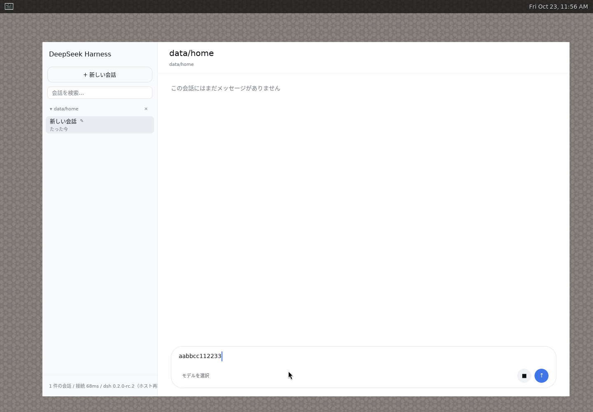
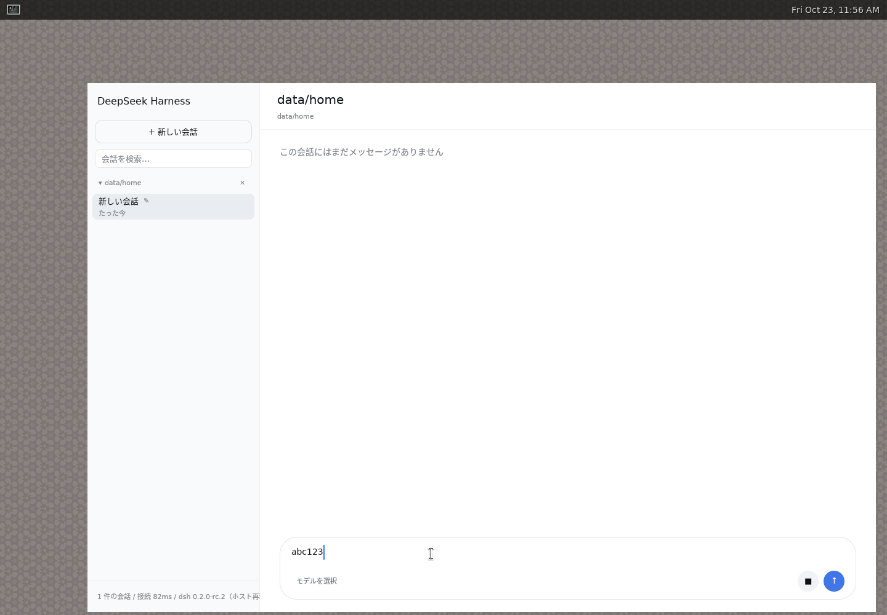

# GPUIコンポーザの実入力検証

2026-10-23、instaboxのDebian Linux x86_64で実ウィンドウを検証しました。
Xvfb 1440×1000 → Weston 14のX11 backend → GPUI 0.2.2のWayland接続です。
実ハーネスはDSH 0.2.0-rc.2、描画はソフトウェアVulkanを使用しました。
入力確認12経路の範囲は、モデル呼出しを伴わない編集操作です。

## 結果

同じOS入力試験で、未修正版は `abc123` が `aabbcc112233` となって失敗し、
修正版は12経路すべて成功しました。画面の目視に加え、Ctrl+A/Cで選択した
エディタ本文をWaylandクリップボードから読み戻し、期待文字列と完全一致で比較します。
各ケースの実値とスクリーンショットは [results.json](results.json) にあります。

補足で通常Enterも実行し、実DSHセッションの `turnOutline.prompt` が
`SEND_PIPELINE_abc123` と完全一致することを確認しました。
[保存結果](send-proof.json) は入力保存までの証跡で、モデル応答の成功は検証範囲外です。

| 操作 | 修正版の読戻し |
| --- | --- |
| ASCII | `abc123` |
| 同じ文字の連続入力 | `bookkeeper 111 aaa` |
| Shift・記号 | `ABC_xyz-+=!?123` |
| カーソル途中への挿入 | `aXbc` |
| Backspace / Delete | `abc` / `acd` |
| 全選択の置換 | `Z` |
| 切取・貼付 | `prefix:Copy-me-123` |
| Shift+Enter | `line1`、改行、`line2` |
| Unicode貼付 | `日本語🙂 café`、改行、`2行目` |
| 絵文字をBackspace | `A🙂B` → `AB` |
| 貼付時のCR・NUL除去 | `A\r\nB\0` → `A\nB` |

Waylandの通常Enterは `key_char=None` でもIME変換中とは限りません。
未確定範囲の有無でEnterの扱いを決め、変換中のEnterを送信操作から守ります。
この判定とdead keyの扱いは単体試験でも確認しています。

## 実画面

修正前:

修正後:

12経路の実画面を順に並べたGIFです（各画面1秒、元のPNGも保持）。

## 再実行と制限

`apps/rdsh-desktop/tests/composer-wayland.py --help` に必要ツールと環境変数を記載しています。
同じ1440×1000のWestonに対し、ビルドした実行ファイルと証跡保存先を渡してください。
テスト専用HOMEを作成し、最後に自分が起動したハーネスを停止します。
未修正版にも同じ試験を実行すると、最初のASCII照合で失敗します。

日本語IMEの実変換・preedit操作、macOS、Windowsはこの実機試験の対象外です。
Unicodeの保存は読戻しで検証しており、このVMのフォントでは絵文字が代替グリフになります。

本PRはGPUIの整備PRを基点とし、入力動作だけを変更します。整備の差分は含めません。
`--verify-send` を付けると、編集12経路に加えて通常Enterの送信と正確なprompt保存も検証します。
