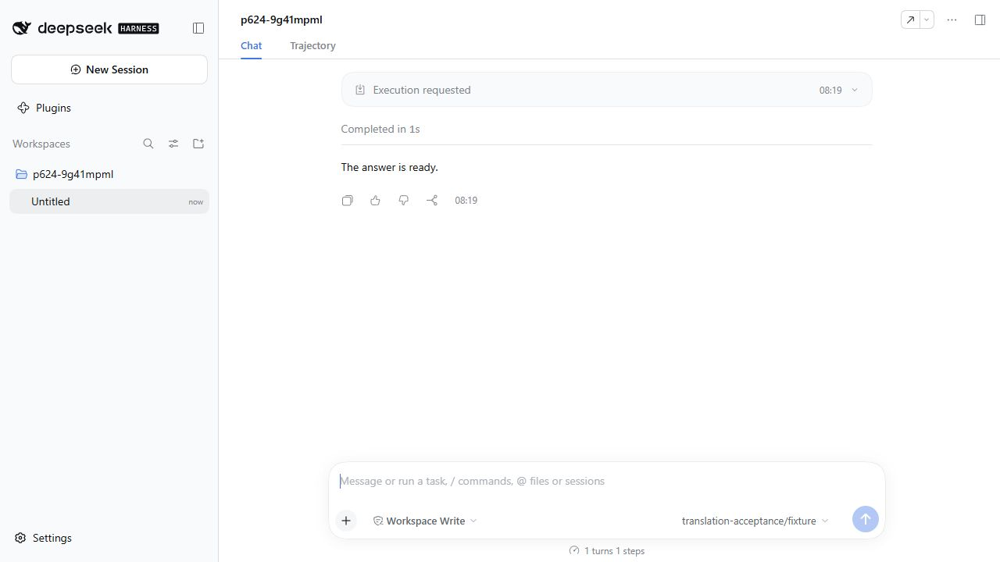
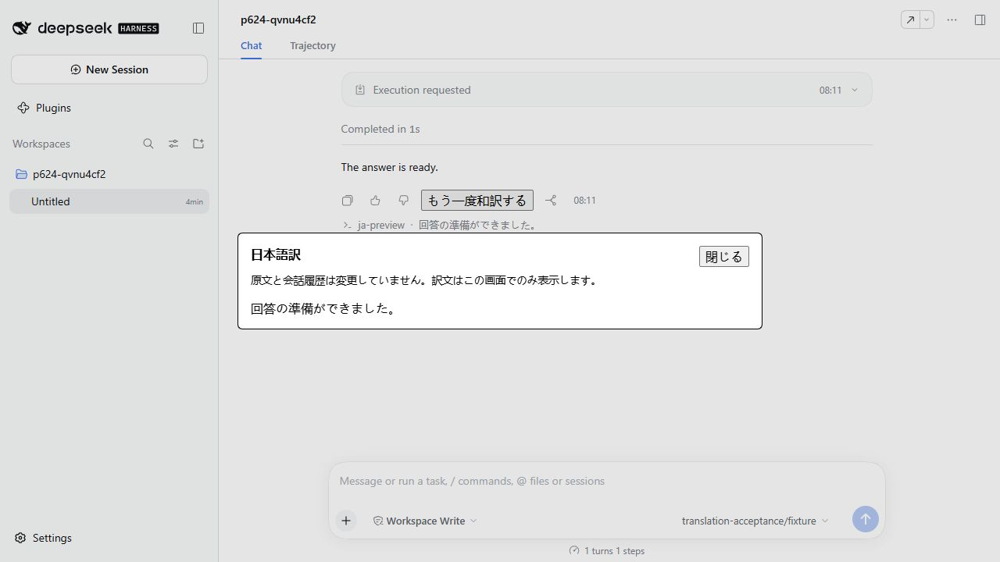
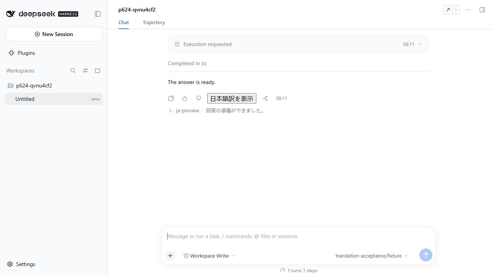

# #448 翻訳ボタンと表示の受入記録

DSH 0.2.0-rc.2の実Webプロファイルへ本プラグインを導入し、CUAで操作しました。
同じDSHに翻訳プラグインを入れない別の一時プロファイルを比較対象にしています。
両方で実AgentLoopに英語回答を生成させ、providerだけはローカルの固定応答adapterを使用しました。
ユーザーのプロファイル・認証情報・モデルAPIは使用していません。

## 変更前後と操作

| 変更前（プラグインなし） | 変更後（訳文表示） |
| --- | --- |
|  |  |



- 変更前は同じ英語回答に翻訳ボタンがありません。
- 導入後は実assistant-actionsスロットに「日本語訳を表示」が現れます。
- ボタンから実Remote・CommandRuntime・LLMを通り、日本語訳ダイアログが開きます。
- 「閉じる」で元の画面へ戻ります。再読込後も原文と1ターンの会話が残り、訳文表示だけが消えます。
- DSHの通常のコマンドログは残ります。原文の置換や翻訳ターンの追加は行いません。

画像はブラウザーが返す実JPEGキャプチャを、復号後の画素を変えずにPNG化したものです。
GIFは「操作前→表示→閉じた後」の実キャプチャ3枚から作成しました。
画面を合成したモックではありません。生成条件と画像hashは[capture-manifest.json](capture-manifest.json)に記録しています。

## 検証コマンド

```sh
node --test tests/translation-preview.test.mjs
RDSH_NATIVE_MODULES=/path/to/isolated/dsh/node_modules npm run test:translation --prefix tests/e2e
```

専用テストは14件成功。native受入は実AgentLoop・CommandRuntime・LlmRuntime・sessionで成功し、
現在のrequest-headerのroute選択、独立翻訳1回、原文・turn・surface・deriveMessages不変、
`command/run`・`command/done`だけが追加されることを確認しました。
Web確認で見つかった親Remoteの注入宣言不足と、操作欄で訳文が重なる問題も修正しています。

## 検証の限界

固定応答なので、実モデルの翻訳品質・料金・provider固有障害は検証していません。
Electron Desktop GUI、実スマートフォン、macOSは検証していません。
実Webでの確認と、リポジトリ全体の必須チェック成功は区別します。
Windowsのsymlink作成権限、既存のClippy警告、非対応のnative searchに関する失敗を、
この機能の試験成功で置き換えていません。必須CIと他者レビューを通してからマージします。
