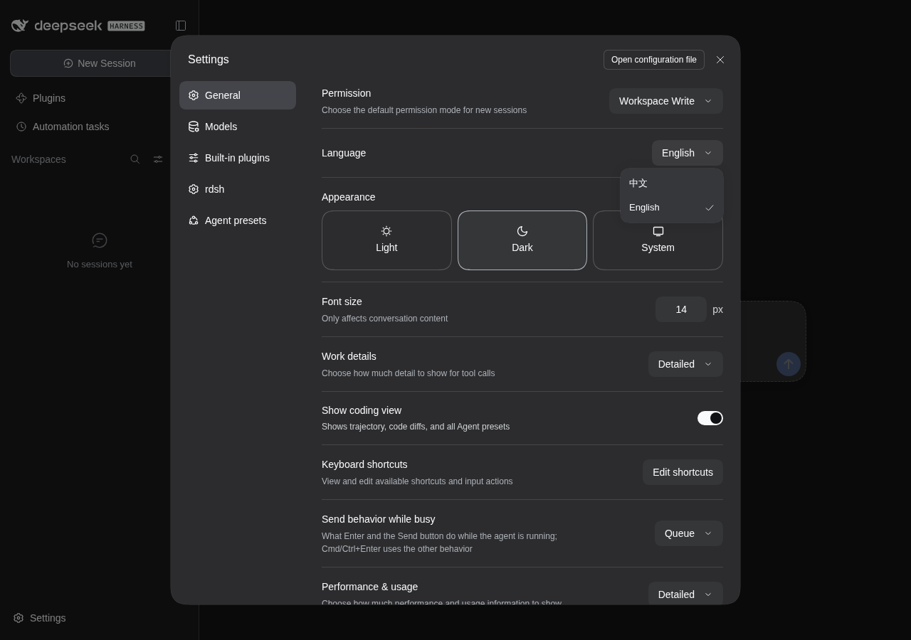
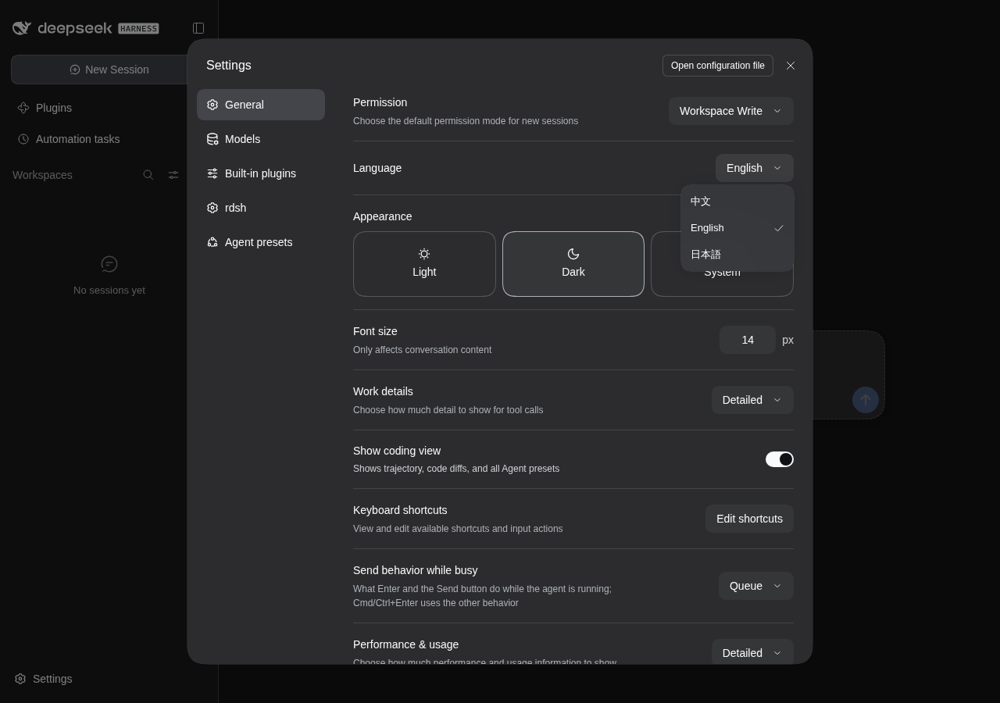
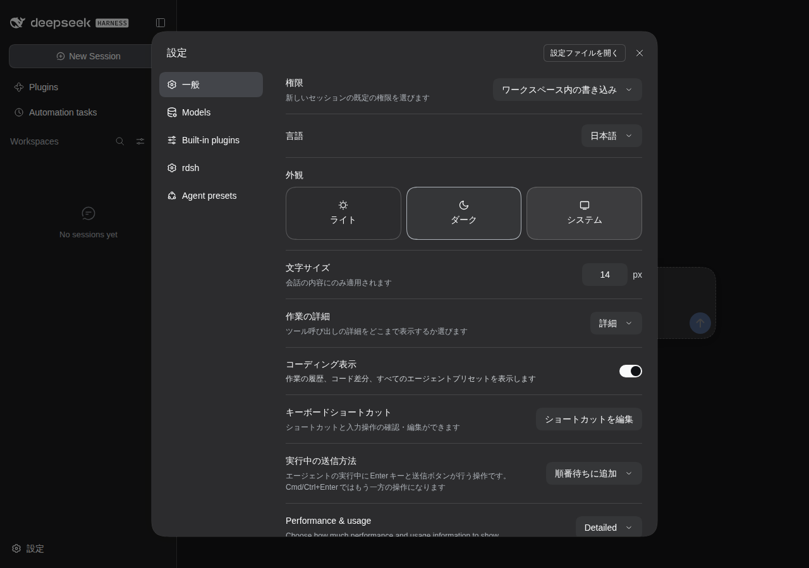
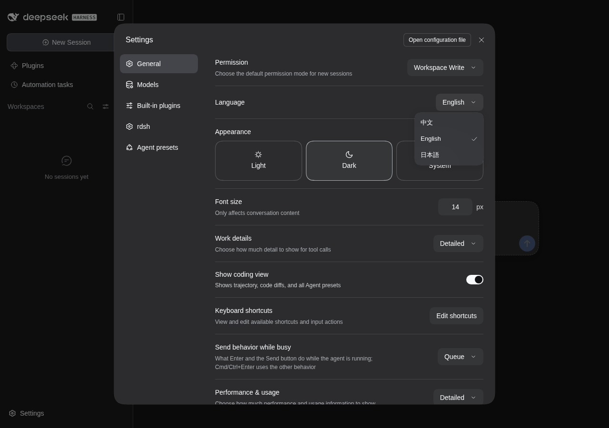

# Languageメニューの日本語選択（2026-10-12）

DSH 0.2.1-alpha.1の実際のWeb UIで、同梱の `rdsh-settings` による日本語登録を確認した。
ブラウザはChromium、画面は1280×900、ブラウザの言語は `en-US`。
変更前は `da165af004822a3698ac74d85c3b094bda4fcab9` の `client.js` を同じDSHへ読み込んだ。
各試験は独立した一時HOME・DSH_HOMEを使い、資格情報を渡さず、Discord表示も無効にした。

| 操作 | 確認結果 |
| --- | --- |
| 変更前のLanguageメニュー | 中文、Englishの2項目 |
| 変更後のLanguageメニュー | 中文、English、日本語の3項目 |
| 日本語を選択 | General、言語、権限、外観、文字サイズ、作業の詳細、ショートカット、送信方法が日本語になる |
| 未翻訳の項目 | ModelsなどはDSHの英語辞書で表示される |
| 中国語、英語へ戻す | 既存の表示へ切り替わり、文書の言語もそれぞれ `zh-CN`、`en` になる |
| 言語設定の保存 | 4回の選択すべてでDSH Hostの保存成功を確認 |
| ページを再読み込み | 日本語を保持 |
| DSHを停止・再起動して、新しい英語ブラウザで開く | 日本語を保持 |

[ブラウザ試験の記録](japanese-language-20261012/language-results.json)。
日本語の文書言語は `ja`。ブラウザの未処理例外は0件だった。
旧DSHと既存の日本語パックについては、クライアント単体試験で設定セクションの継続と登録の重複回避を確認した。
旧DSH、Electron Desktop、非ループバック接続の実画面試験は行っていない。

## 実画面

変更前:



変更後:



日本語を選んだ後:



選択前後の実画面キャプチャ2枚を、2秒ずつ表示するGIF:



## 実行した検査

Linux（WSL / FlashNext）で以下が通過した。

```sh
cargo fmt --check
cargo clippy --all-targets -- -D warnings
cargo test --release
cargo test --release --example benchmark_extended
cargo test --release --example benchmark_models
node --test tests/plugin-security.test.mjs tests/settings-client.test.mjs tests/japanese-locale.test.mjs tests/update-banner.test.mjs tests/feature-switches.test.mjs tests/model_benchmark/fence.test.mjs
BIN=./target/release/rdsh sh tests/regress.sh
RDSH_E2E_BIN=./target/release/rdsh npm test --prefix tests/e2e
RDSH_HARNESS_BIN=/path/to/original/dsh RDSH_LANGUAGE_BASELINE_CLIENT=./target/language-baseline/client.js npm run test:language --prefix tests/e2e
```

プラグイン検査は62件、CLI回帰は57項目が通過した。
既存のブラウザ試験はsetup・native serve・project CLIの3フローと更新バナーの13フローが通過した。
Windowsでも `node --test tests/japanese-locale.test.mjs tests/settings-client.test.mjs` の11件が通過した。

日本語の登録と解除はDSHの `locale.addLanguage` / `locale.register` とCordisのeffectを使う。
表示言語の保存はDSHの既存処理に委ね、`rdsh.json` の設定項目は増やしていない。
