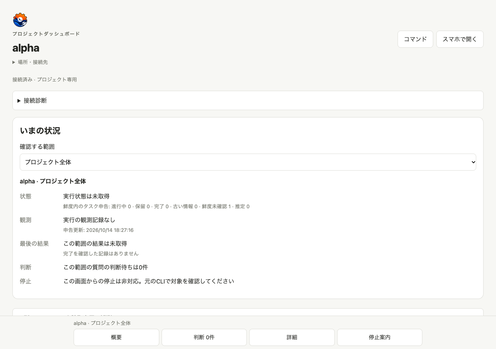

# Three product languages, 2026-10-14

The CLI, native setup/Web pages, project dashboard and bundled settings/Muse Code/Discord integrations now use English, Simplified Chinese and Japanese for owned copy. Source base: `f3b836e34b871452a4b03723159d9a2821b3062b`. The earlier captures used `cb100b1`; intervening upstream commits change search/compute/settings documentation, not those UI assets. No provider login, model call, external Discord publication, installed binary replacement or release occurred. Muse Code language behavior is checked through its real adapter with synthetic catalog/worker responses; the live Muse CLI/catalog was not revalidated on this Mac, where the CLI is unavailable.

## Visible changes

The PNGs below are actual desktop/mobile browser captures against real Rust servers, the project CLI/MCP and a temporary original Harness Web profile. All fixtures are synthetic. The task title `未取得` and question `未取得 — 日本語の原文を保持` intentionally remain Japanese in every language. Runtime/API JSON, model IDs, filenames, user text and pruned content remain original values. Native session timestamps preserve the API's UTC minute precision while formatting labels and numbers in the selected language.

| Surface | Before | English | Simplified Chinese | Japanese |
| --- | --- | --- | --- | --- |
| Project desktop | [PNG](before-project-desktop.png) | [PNG](en-project-desktop.png) | [PNG](zh-CN-project-desktop.png) | [PNG](ja-project-desktop.png) |
| Project mobile | [PNG](before-project-mobile.png) | [PNG](en-project-mobile.png) | [PNG](zh-CN-project-mobile.png) | [PNG](ja-project-mobile.png) |
| Native desktop | [PNG](before-native-desktop.png) | [PNG](en-native-desktop.png) | [PNG](zh-CN-native-desktop.png) | [PNG](ja-native-desktop.png) |
| Native mobile | [PNG](before-native-mobile.png) | [PNG](en-native-mobile.png) | [PNG](zh-CN-native-mobile.png) | [PNG](ja-native-mobile.png) |
| Setup desktop | [PNG](before-setup-desktop.png) | [PNG](en-setup-desktop.png) | [PNG](zh-CN-setup-desktop.png) | [PNG](ja-setup-desktop.png) |
| Setup mobile | [PNG](before-setup-mobile.png) | [PNG](en-setup-mobile.png) | [PNG](zh-CN-setup-mobile.png) | [PNG](ja-setup-mobile.png) |




The original Harness settings flow additionally switches and persists en → zh-CN → ja, retains custom goal/Discord details, rejects corrupt settings without saving, keeps the last selected language on reload error, and recovers after repair. [English](harness-settings-en.png), [Chinese](harness-settings-zh-CN.png), [Japanese](harness-settings-ja.png), [corrupt-settings error](harness-settings-error.png), [390 px mobile](harness-settings-mobile.png), [observations](harness-results.json). The surrounding Harness shell deliberately stays English in this isolated plugin test.

CLI before/after output: [before](before-help.txt), [en](en-help.txt), [zh-CN](zh-CN-help.txt), [ja](ja-help.txt). These are actual generated help outputs with trailing whitespace removed for repository text-file checks; no help text is reconstructed.

## Functional coverage

- Mandatory Rust format, clippy, 240 release tests (180 unit + 60 integration), both benchmark example test suites, model fence and shell regressions pass after the upstream merge; [executed commands](native-validation.json) and [test output](native-final.txt) record the result.
- Browser tests repeat setup, native dashboard and project CLI/MCP/HTTP flows in all three languages, including original Japanese input, pruning, persisted answers, SSE drafts, server restart and old-token revocation. Thirteen existing update-banner flows also pass. [Final run output](browser-final.txt) records all three languages.
- Optional original Harness settings integration uses no provider key and leaves Discord disabled. The real host confirms three language saves and safe corruption/retry. Both desktop and 390 px mobile are accepted by this test.
- Plugin tests exercise settings, default Discord activity and Muse Code catalog/errors in all three languages; explicit custom details, model names, provider IDs and external error text are preserved.
- Native HTTP regressions cover both servers: Darwin accepted sockets wait for fragmented headers; empty preconnect/EOF receives no HTTP status, while partial requests retain 400/408. Ten-second read/write bounds and 32 connections remain. Removing either blocking-mode reset or idle handling makes its negative control fail.

macOS has no kernel-owned child-process or read-only native identity backend in this repository. It refuses before managed launch; no PID fallback is added. [The platform ledger](dashboard-platform-ledger.md) lists every excluded positive case and executed negative case. macOS normal dashboard tests pass 236/330 with 94 explicit platform skips; Windows normal dashboard tests pass 324/330 with 6 platform skips and no failures, including native ownership/identity positives through its existing Job Object backend. [The retry investigation](windows-retry.md) records a reproduced fingerprint-contention failure and its positive-fixture-only timing correction; the 700 ms child timeout and all negative tests remain. This language change does not add a macOS managed-process backend.

## Performance evidence

Measurements use the existing `scripts/benchmark.py` and `benchmark_extended` with temporary synthetic files, three warmups and fifteen observations per case. Parent wall time includes CLI process launch; the native HTTP series measures a persistent server. Provider/network latency, model generation, browser rendering and Desktop startup are excluded. Peak RSS is a separate child observation; concurrent aggregate RSS is not measured. OS filesystem caches remain warm.

Earlier [loaded basic run](performance-loaded.json), [repeat](performance-repeat.json) and [extended run](performance-extended.json) retain every observation against the earlier `cb100b1` baseline. Host contention produced large tails and reversed several median ratios between runs; these exploratory results do not establish a speedup or regression. [The final report](performance.md) compares the merged candidate with the current upstream source, identifies both binaries by SHA-256 and retains all output-equality checks. No performance gate, product deadline or concurrency limit was relaxed.

## Reproduce

```sh
cargo fmt --check
cargo clippy --all-targets -- -D warnings
cargo test --release
cargo test --release --example benchmark_extended
cargo test --release --example benchmark_models
node --test tests/model_benchmark/fence.test.mjs
sh tests/regress.sh
(cd dashboard && npm ci && npm test)
RDSH_E2E_BIN=./target/release/rdsh npm test --prefix tests/e2e
node --test tests/settings-client.test.mjs tests/discord-presence.test.mjs tests/plugin-security.test.mjs plugins/rdsh-llm-muse-code-subscription/test/bridge.test.mjs
RDSH_HARNESS_BIN=/path/to/original/dsh npm run test:harness --prefix tests/e2e
LC_ALL=C LANG=C python3 scripts/benchmark.py --bin ./target/release/rdsh --baseline /path/to/current-upstream/rdsh --n 15 --output /tmp/performance.json
LC_ALL=C LANG=C cargo run --release --example benchmark_extended -- --bin ./target/release/rdsh --baseline /path/to/current-upstream/rdsh --n 15 --output /tmp/performance-extended.json
```

`RDSH_CHROME_PATH` can use an existing Chrome installation; no browser download is required. [Browser test documentation](../../../tests/e2e/README.md) explains isolated paths and cleanup. The baseline binary is an archived source build, not the user's installed `rdsh`.

## CI first-run follow-up

The first GitHub matrix exposed an environment-dependent assertion: a clean home correctly prints the Chinese first-use guidance, while the test expected a recognized external login or import hint. The settings fixture now clears inherited credentials and uses private HOME/USERPROFILE/XDG/APPDATA paths. Separate synthetic login tests verify the recognized-source branch without reading real accounts or exposing/copying any value. The empty-home case rejects the previous assertion locally, reproducing the CI failure.

The same follow-up completes owned authentication dispositions, skipped-provider notes, unknown expiry, interactive setup and settings/policy-validation diagnostics. CLI language changes leave existing JSON detail/note strings, error reason codes, identifiers and raw OS/Serde details unchanged. The real POSIX terminal test [passes six cases](cli-tty-results.json) and runs in the existing Linux/macOS native CI jobs. It refuses credential persistence and enters no real key. Replacing the new auth implementation with the pre-fix source makes both [owned-display](auth-display-negative.txt) and [terminal-copy](auth-tty-negative.txt) regressions fail; the final source is restored and passes. Windows terminal interaction is not claimed by this POSIX test.
