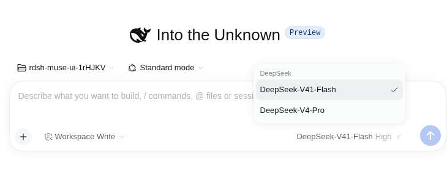
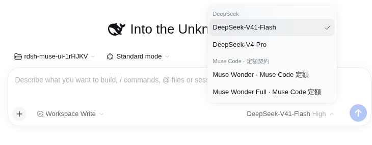

# Muse Code 定額接続の確認記録

2026-10-13。ローカルのMuse Code接続試作を `plugins/rdsh-llm-muse-code-subscription/` へ移し、PC固有の実行ファイルパスを設定可能にした。プラグインは明示的に追加する方式で、既存のプロバイダーや既定モデルは変更しない。

## 実モデルと実画面

Harness `0.2.1-alpha.1`、公式SDK `1.4.6`、Muse Code `1.4.6-R6000.1`、有効な既存定額ログインを使用。

- 移植したアダプターからWonderが「Muse Code 定額接続 OK」を返した。Windows側の実行は10,660 ms、WSLアダプターからWindows補助Nodeへ標準入出力で接続する実行は7,825 ms。別々の短い疎通試験であり、性能比較ではない。
- 定額OAuth/device-codeログインを補助プロセスが確認し、Muse Code自身が認証とモデル要求を担当した。Harnessへ資格情報をコピーせず、従量課金APIキーへのfallbackを追加していない。
- 両実行でトークン使用量通知はなかった。確認記録のusageは `null` とし、ゼロや推定料金を作っていない。
- 資格情報を渡さない隔離Webプロファイルで、実際のHarnessのモデル選択を確認した。追加前はMuseの項目がなく、追加後に通常のWonderとFullが表示され、Fullを選択できた。この画面検査はモデルを呼び出していない。

[実モデルの記録](muse-code-subscription/live-verification.json)、[実画面の記録](muse-code-subscription/ui-verification.json)。画像は1100×820の実ブラウザー画面から、モデル選択と入力欄の領域を直接キャプチャしたPNG。

追加前:



追加後:



モデル選択の変更を文字でも示す:

```diff
 DeepSeek
   DeepSeek-V41-Flash
   DeepSeek-V4-Pro
+Muse Code · 定額契約
+  Muse Wonder · Muse Code 定額
+  Muse Wonder Full · Muse Code 定額
```

## 回帰検査

Windows NodeとWSL/Linux Nodeでプラグインの14テストを通過。認証条件、APIキー除外、許可されたHarnessツール名とJSON引数、任意の使用量通知、SDKのschema不一致と独自ツール使用の拒否、SDK iterator待機中の停止、実子プロセスでの応答・キャンセル・タイムアウト・異常終了、Harnessイベントへの変換とdisposeを検査した。これらの回帰テストはプロバイダーを呼び出さない。

リポジトリの必須検査も通過:

- `cargo fmt --check`
- `cargo clippy --all-targets -- -D warnings`
- `cargo test --release --locked`（136 unit / 12 credential lock / 16 native E2E / 12 token query）
- `cargo test --release --example benchmark_extended` と `benchmark_models`
- `node --test tests/model_benchmark/fence.test.mjs`
- releaseビルドと `BIN=…/release/rdsh sh tests/regress.sh`（62 checks）
- `RDSH_E2E_BIN=…/release/rdsh npm test --prefix tests/e2e`（既存ブラウザーE2Eと更新バナー13 flows）

実際のモデル選択を再確認する場合は、プラグインに `npm ci` を実行したうえで、インストール済みの元Harnessを指定する:

```sh
RDSH_HARNESS_BIN=/path/to/original/dsh npm run test:muse --prefix tests/e2e
```

この任意テストは一時HOME/DSH_HOMEだけを使い、ユーザーのプロファイルや認証を変更しない。Windows Nodeを呼ぶWSL設定例は [プラグインの導入手順](../../plugins/rdsh-llm-muse-code-subscription/README.md) を参照。

## 確認範囲

PR内の移植版は、Wonderの実応答、WSL→Windows通信、実画面でのFull選択、プロバイダーを使わない回帰検査を確認した段階。元のPC固有試作には2026-10-13のFull/Bashツール往復と実モデル停止の記録があるが、移植版での実AgentLoopを通じたFullの長時間実行、headlessのタスク実行、画像・動画・音声は今回確認していない。CLIとSDKの更新時には再検証が必要。
