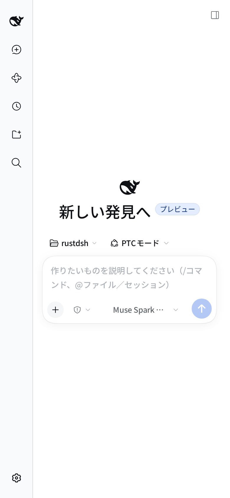
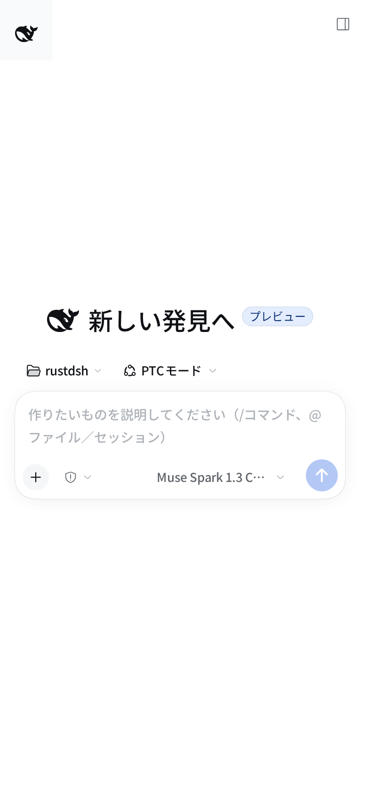

# Phone-width layout evidence (rdsh-mobile-ui)

Parent: the DSH Web chat as shipped with DSH `0.2.0-rc.2`, captured on
2026-10-14 against the real local server (`127.0.0.1:3080`) in Chromium at a
390x844 viewport (deviceScaleFactor 2). Both captures show the empty state, so
no conversation content is recorded.

| Stage | Capture | Observed |
| --- | --- | --- |
| Before |  | 56px icon rail stays in the grid: chat column 334px (left 56px), composer 327px |
| After |  | rail attribute `closed`: chat column 390px (left 0), composer 383px, logo 36x36, rail items hidden |

[geometry.json](geometry.json) records the measured boxes: with the plugin the
document keeps `scrollWidth == innerWidth == 390`, the open-session scroll body
grows from 327px to 383px, and the same page at 1280x900 keeps the stock sidebar
(280px sidebar, 1000px centre column, no rail attribute).

The plugin was also installed into the live web profile and re-measured without
any injected CSS; the resulting 390px layout was byte-identical to the after
capture above. This is a viewport layout check, not physical-phone, Tailscale or
acceptance testing.
