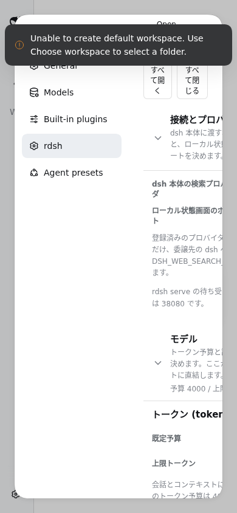
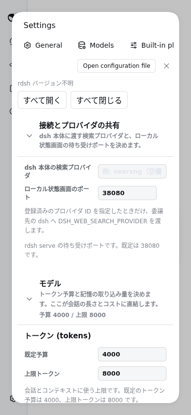

# rdsh設定のモバイル幅検証

2026-10-23、instaboxの実DSH 0.2.0-rc.2 Webプロファイルへローカルの
rdsh-settingsを導入し、Chromium 154で検証しました。Electronと物理スマートフォンは未検証です。

幅390×844では、修正前は本文幅106px・スクロール幅260px、ナビゲーションと本文が
横並びでした。ルート要素へ既存CSSのアンカーを付けた修正版は、本文幅318px、
横はみ出しなし、モーダルのflex-directionはcolumnです。

設定保存→ファイル読戻し→再読込、Discord部分保存、空ポートの既定値復帰、
既存キー保持、en/zh-CN/ja切替、設定ファイル破損時の400とエラー表示、
ファイル修復後の再読込まで確認しました。[結果JSON](results.json) に実測値を保存しています。
JavaScript例外は0、期待した破損設定のHTTP 400は1回でした。

## 実画面

修正前:

修正後:

実ブラウザー録画から作成した操作GIFです。

## 再実行と制限

`tests/e2e/harness-settings.mjs` を、インストール済みDSHを指定して実行します。
起動方法と任意の動画保存は [E2E README](../../../tests/e2e/README.md) を参照してください。
折りたたみカードを開いてから入力し、ポートはラベル付きspinbuttonで指定します。
幅280px以上・横はみ出しなし・ナビゲーションが上に来ることを自動判定します。

この空のテストプロファイルでは、DSHがdefault workspace作成失敗のtoastを表示します。
モバイルPNGはtoastの自然消失後に採取しています。workspace作成の成功は主張していません。
外部モデルへの送信や本物のDiscord接続は行っていません。
