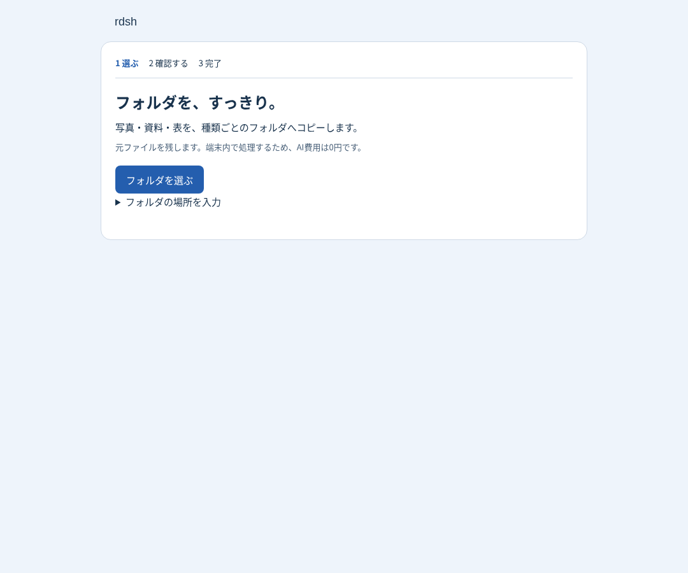
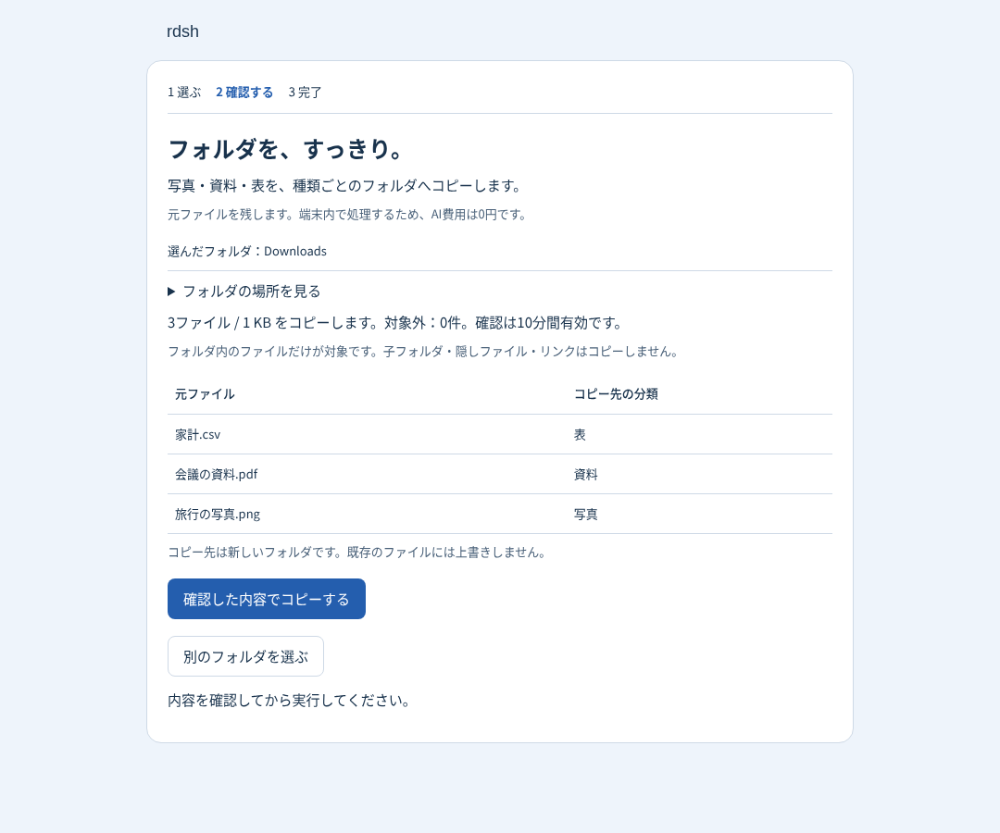
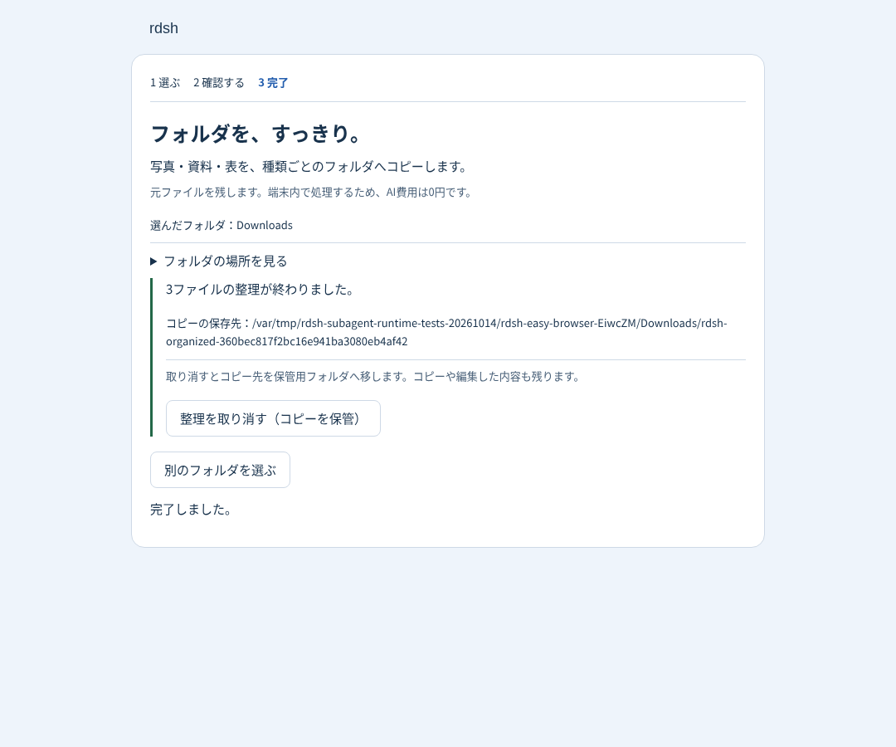
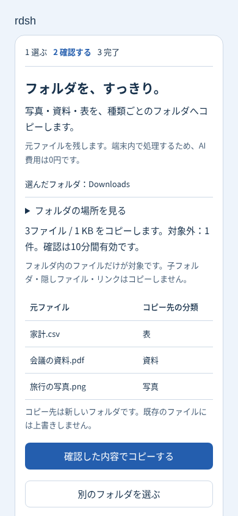

# 0.4.0に向けたファイル整理と探索用サブエージェント

一般ユーザー向け導線の最初の実装は、DSH Desktop / Web上の
「フォルダ選択 → コピー内容確認 → 実行 → 保存先確認 → 取り消し」です。
元ファイルを保持するコピー方式を採用しています。
取り消しではコピー先全体を隠し保管フォルダへ移し、後から編集したコピーも残します。
AI接続や会話の履歴は使わず、拡張子による分類を端末内で実行します。
既存のDSHの画面、フォルダ選択、認証、エージェント実行を利用します。

## 検証

- 新プラグイン19件：通常のコピーと取り消し、確認後の変更、リンク差し替え、
  既存出力、フォルダ移動、再起動復旧、期限・件数制限、GUI認証、
  サブエージェントの待機・キャンセル・破棄失敗・ネイティブAPI互換性。
- 既存導入・Desktop関連47件：既存プラグイン選択や保存済み設定との互換性。
- Dashboard全体：362件成功・8件スキップ。Git配下を避けた一時フォルダで
  順番に実行して検証しました。
- 実ブラウザ：実際のHTTPハンドラーと画面を使い、合成ファイルで
  確認 → コピー → 取り消しを検証。390px幅、キーボードフォーカス、
  ブラウザの例外、元ファイルの保持を確認。
- DSH 0.2.0-rc.2：公開ヘルパーとツールの読み込み、標準のホームスロットと
  任意プラグインの共存、無効化時の標準入口への復帰を確認。
- 20件の同一依頼による合成比較では、通常のバックエンド呼び出し20件に対し、
  最適化プロバイダーは1件を開始し、19件の実行中重複を拒否。
  実モデルのトークン消費・料金・応答時間は測定していません。

実ユーザーのファイル、認証情報、会話データ、実モデルは検証に使っていません。
画像はDesktop全体ではなく、同じプラグイン描画と実処理を使うブラウザ検証用画面です。

| 開始 | 確認 | 完了 |
| --- | --- | --- |
|  |  |  |

## 対応範囲

コピー・取り消しはLinuxのディレクトリハンドルと `/proc/self/fd` を使用します。
Windows・macOSはプレビューのみ。PC全体の隔離、写真の内容理解、PDF要約、
Excel加工、AIログインの自動化、インストーラーへの標準同梱は未実装です。
作業中の別プロセスによるフォルダ変更を完全に隔離する仕組みではありません。
使い方と復旧方法は[ファイル整理のREADME](../../plugins/rdsh-easy-work/README.md)を参照してください。
