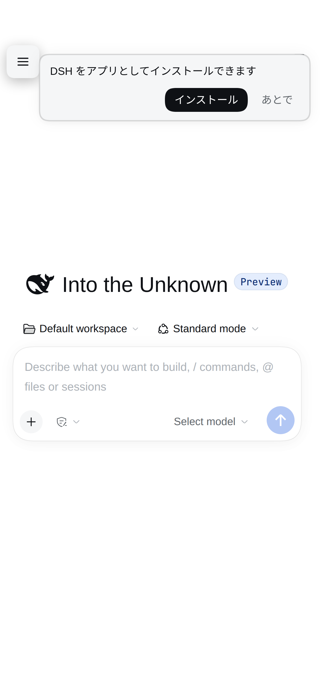
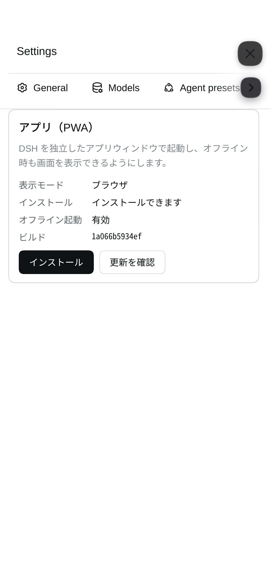

# dsh-mobile-maxxing

> [日本語](README.md) · [English](README.en.md)

本项目提供一组插件，用于改善 DSH（DeepSeek Harness）Web UI 在手机和平板电脑上的使用体验。涵盖 PWA、移动端布局、通知、Markdown 表格和日语 UI，可按需安装相应组件。

**[最新发布 v1.0.4](https://github.com/kuraneko1/dsh-mobile-maxxing/releases/tag/v1.0.4)** · **[发布说明（日语）](RELEASE-NOTES-v1.0.4.md)**

- 移动端主插件可以直接安装在原生 DSH 上，无需安装任何额外的第三方推送通知库。
- 根据设备类型判定是否启用移动模式，不以窗口宽度作为依据，因此窄屏 PC 窗口或支持触控的 Windows PC 不会被误识别为移动设备。
- 在 PC 端，插件不会构建移动版 UI 或表格样式，而是保持标准的 DSH 界面。
- 设备端的显示外观及输入设置将按浏览器分别保存，不会修改宿主端的共享设置。

## 组件

| 组件 | 作用 | 当前版本 | 来源 |
| --- | --- | --- | --- |
| `dsh-mobile-maxxing` | PWA、通知、移动端用户体验（UX） | 1.0.4 | 本仓库 |
| `dsh-md-rendering` | 移动端 Markdown 表格渲染 | 0.1.3 | [kuraneko1/dsh-md-rendering](https://github.com/kuraneko1/dsh-md-rendering) / [`packages/dsh-md-rendering`](packages/dsh-md-rendering) |
| `dsh-locale-ja` | 日语界面（包含 65 个命名空间、2915 个词条） | 0.1.2 | [kuraneko1/dsh-locale-ja](https://github.com/kuraneko1/dsh-locale-ja) / [`packages/dsh-locale-ja`](packages/dsh-locale-ja) |

这三个组件彼此独立，可在插件设置页面中分别启用或禁用。
鉴于本项目旨在保持 PC 端渲染效果不变，“中日韩文字（CJK）的 Markdown 自动链接修复”功能已被拆分至独立的包 `rdsh-markdown-cjk` 中。

## 运行条件

- 验证对象 DSH 版本：**0.2.1-rc.2 / 0.2.1-rc.3**
- 浏览器：当前版本的 Chrome / Edge / Safari（含 iOS 及 iPadOS 版本）
- PWA 与 Web Push：必须通过 **HTTPS 或 localhost** 访问 DSH
- 操作系统通知：浏览器及操作系统（OS）层面均需允许通知权限

由于实际运行情况取决于具体的操作系统、浏览器及推送服务，请在安装后通过设置页面中的“测试通知”功能进行确认。

## 快速入门

### 一次性安装 3 个组件

可以使用以下安装 URL 一次性完成安装：

```sh
curl -fsSL https://raw.githubusercontent.com/kuraneko1/dsh-mobile-maxxing/main/scripts/install-mobile-bundle.mjs | node --input-type=module
```

默认情况下，该操作会将组件安装至 `web` profile 中。其中，移动端主插件和日语语言包将安装各自仓库的 `main` 分支版本，Markdown 表格插件则安装 `v1.0.4` 发布中的 `0.1.3` 版本安装包。
安装完成后，请重启 DSH 并刷新浏览器页面。

若需使用其他 profile：

```sh
curl -fsSL https://raw.githubusercontent.com/kuraneko1/dsh-mobile-maxxing/main/scripts/install-mobile-bundle.mjs | DSH_PROFILE=web-mobile node --input-type=module
```

### 仅安装移动端主插件

```sh
dsh plugin --profile web add https://github.com/kuraneko1/dsh-mobile-maxxing
# 然后重启 DSH 以加载插件 (例如 systemctl --user restart dsh-web.service)
```

### 仅添加日语界面

```sh
dsh plugin --profile web add github:kuraneko1/dsh-locale-ja
```

### 仅添加 Markdown 表格支持

```sh
dsh plugin --profile web add https://github.com/kuraneko1/dsh-mobile-maxxing/releases/download/v1.0.4/dsh-md-rendering-0.1.3.tgz
```

执行 `dsh plugin --profile web add` 会同时更新依赖和 bundle 列表，无需先执行 `cd ~/.dsh/profiles/web`。
日语支持并未包含在移动端主插件中，只有在安装日语语言包后才会出现在语言列表中。

## 首次设置

1. 在移动设备上打开 DSH 的 HTTPS URL。
2. 根据需要将其添加到主屏幕。
    - iPhone / iPad：在 Safari 中点击“共享” → 选择“添加到主屏幕”。
    - Android / Chrome：在菜单中选择“安装应用”或“添加到主屏幕”。
3. 进入 DSH 的 **设置 → Mobile**。
4. 启用通知功能，确认浏览器及操作系统已授予相应权限，并执行测试通知。
5. 如果已安装日语支持，请在显示语言选项中选择“日语”。
6. 出现更新提示后，请在不影响当前会话的合适时机重新加载页面。

## 屏幕截图

<p>
  
  
</p>

## 主要功能

### PWA 与移动端用户体验（UX）

- 支持“添加到主屏幕”、应用外壳（App Shell）离线启动及更新通知
- 侧边栏改为抽屉式，支持一键访问设置，适配安全区域（Safe Area）
- 确保键盘弹出时输入框可见；终端专用按键（Esc、Tab、方向键、Ctrl）
- 支持代码与代码审查（Review）内容的自动换行；工具摘要与 Bash 预览的移动端适配
- 优化文件搜索、右侧面板、模型菜单，以及长按和滑动操作
- 支持浅色/深色/跟随系统主题；提供“仅终端区域设为深色”的显示模式

根据设备类型判定是否启用移动模式，不以窗口宽度作为依据。仅在启用移动端 UI 时，才会应用专用样式并注册事件处理程序。

### 仅对本设备生效的设置

在“设置 → Mobile”中，可以针对每个浏览器分别调整以下选项：

- 正文、代码及终端的字体大小
- 显示语言与主题
- 工作详情、已完成轮次的折叠时机、运行期间的 Enter 键行为、性能显示
- 通知、提示音及音量
- 新会话的默认权限设置

这些设置将保存在 `localStorage` 中，不会影响电脑或其他设备上的设置，也不会更改宿主端的共享设置。

### 通知

| 应用状态 | 行为 |
| --- | --- |
| 前台显示 | 显示应用内横幅并播放通知音。若宿主端及时收到横幅显示确认（ACK）信号，则跳过对应订阅的此次 Web Push |
| 后台、断开连接或已关闭 | 通过 Web Push 发送操作系统通知 |
| 点击通知 | 打开对应的会话 |

默认情况下，会在本设备发起的对话轮次结束时发送通知。对于需要用户回答的问题，通知不受轮次发起设备的限制。
将 profile 中的 `notifications.onlyMobileTurns` 设为 `false`，即可将 PC 端发起的对话轮次也纳入通知范围。

v1.0.0 版本还增强了通知的可靠性与安全性：

- 通过 `requestId` 将发送请求与实际用户消息对应起来，避免延迟请求被误归到其他轮次
- 不会仅因 User-Agent 相同就删除其他设备的订阅；仅清理明确指定的旧推送端点（endpoint）对应的订阅，以及 Push 服务返回 404 或 410 的失效订阅
- 并行向各设备发送通知，每次发送均设有 10 秒超时
- 对于用户明确启用的通知订阅，在应用启动、恢复联网或页面重新可见时自动恢复
- 按 profile 分别保存对外访问的 origin（源）和尚待匹配的发送请求标识
- 推送端点（endpoint）仅允许 HTTPS；校验 DNS 返回的全部地址均为公网地址，并连接到这些已验证的地址，不跟随重定向

通知加密及 VAPID 均使用 Node.js 标准模块实现，无需依赖外部的 `web-push` 库。

### Markdown 表格

- 针对移动端调整横向滚动、字体大小、边框、留白以及与主题相符的背景。
- 即使未安装移动端主插件、仅单独安装本插件，也会根据设备信息判断是否为移动设备。
- 优先遵循明确指定的桌面（desktop）/ 移动（mobile）模式；在 PC 端，不会加载 React 或注册相关样式。
- 不会改变 Markdown 的解析方式，也不会改动表格以外的正文内容。

详情请参阅 [`packages/dsh-md-rendering/README.md`](packages/dsh-md-rendering/README.md)。

### 日语 UI

- 包含 65 个命名空间和 2915 个词条的翻译，无英语回退（fallback）内容。
- 不包含在移动端主插件中；日语资源仅由独立的 `dsh-locale-ja` 包提供。
- 兼容 DSH 0.2.1-rc.2 / rc.3 的对等依赖（peer dependency）。
- 若本地化翻译词典不完整，`pack-all` 将显示 `REFUSED`，且不会打包分发该语言包。

详情请参阅 [`packages/dsh-locale-ja/README.md`](packages/dsh-locale-ja/README.md)。

## 安装脚本配置

| 环境变量 | 用途 | 默认值 |
| --- | --- | --- |
| `DSH_PROFILE` | 安装目标 profile | `web` |
| `DSH_BUNDLE_TAG` | 指定 Markdown 表格插件安装包所在的发布标签；显式设置时，移动端主插件也会使用相同的 Git 分支或标签 | `v1.0.4`（移动端主插件默认使用 `main`） |
| `DSH_BUNDLE_BASE_URL` | Markdown 表格插件安装包的基础下载 URL | 指定发布标签对应的 GitHub Releases 下载地址 |
| `DSH_LOCALE_REF` | 安装日语语言包时使用的 Git 分支或标签 | `main` |
| `DSH_MD_VERSION` | Markdown 表格插件的版本号 | `0.1.3` |

示例：

```sh
DSH_PROFILE=web-mobile \
DSH_BUNDLE_TAG=v1.0.4 \
DSH_LOCALE_REF=main \
DSH_MD_VERSION=0.1.3 \
  node scripts/install-mobile-bundle.mjs
```

未设置 `DSH_BUNDLE_TAG` 时，移动端主插件直接从默认的 `main` 分支安装；显式设置后，则从该值对应的 Git 分支或标签安装。例如，上述配置会从 `v1.0.0` 标签安装移动端主插件。

若未自定义 `DSH_BUNDLE_BASE_URL`，指定的 GitHub Release 中必须包含与 `DSH_MD_VERSION` 对应的 Markdown 表格插件安装包，例如 `dsh-md-rendering-0.1.3.tgz`。

## 故障排查

### 没有显示为移动端界面？

- 插件不以屏幕宽度作为移动端判定依据。请检查浏览器提供的设备信息，包括 UA（User Agent）、平台信息（platform）和触控能力（touch）。
- 若仍在使用旧版离线应用外壳，请在联网状态下重新打开页面，以更新 HTML 和客户端脚本。
- 若 DSH 更新后，部分移动端样式不再生效，可能是页面结构（DOM）的变化使插件无法识别相应元素。此时，相应部分会保留 DSH 的标准界面。

### 收不到通知？

1. 请确认是否通过 HTTPS 或 localhost 访问。
2. 请检查浏览器及操作系统的通知权限设置。
3. 请前往“设置 → Mobile”检查通知订阅状态，并执行通知测试。
4. 在默认配置 `onlyMobileTurns: true` 下，PC 端发起的对话轮次结束时不会触发通知。请同时检查移动设备端的相关设置和 profile 配置。
5. 如果使用了反向代理访问 DSH，请在浏览器中打开 DSH 的对外访问地址，并重新注册对应 origin 的通知订阅。

### 安装的仍是旧版本？

pnpm 按 URL 缓存安装包。更新时，请使用带版本号的安装包（tarball）URL，或明确指定 Git 分支或标签；不要仅替换同一个无版本号 URL 所指向的文件内容。

也请避免在同一个下载 URL 下替换已发布 Release 的附件。

### 在 PC 端表格样式未发生变化

这是预期行为。`dsh-md-rendering` 仅适用于移动端，在 PC 端不会注册相关样式。

## 文档

- [详细用法（日语）](packages/dsh-mobile-maxxing/docs/USAGE.ja.md)
- [详细用法（英语）](packages/dsh-mobile-maxxing/docs/USAGE.en.md)
- [移动端主插件的 README](packages/dsh-mobile-maxxing/README.md)
- [开发说明](CONTRIBUTING.md)
- [实现参考来源](CONTRIBUTING.md#実装の参考元)
- [v1.0.0 发布说明](RELEASE-NOTES-v1.0.0.md)

## 开发

验证环境使用 Node.js 24。

```sh
npm test
npm run test:locale
npm run check:locale
npm run check:locale:generated
node scripts/pack-all.mjs
```

主要结构：

```text
packages/dsh-mobile-maxxing/  主插件的 host / client / service worker / tests
packages/dsh-md-rendering/    独立的 Markdown 表格插件
packages/dsh-locale-ja/       日语词典及生成产物
scripts/                     安装程序与打包脚本
tools/                       日语词典的生成与校验
```

没有统一的构建流程。浏览器端直接分发 JavaScript 源码，宿主端使用 Node.js 标准模块运行。
若要直接安装本地检出的代码：

```sh
dsh plugin --profile web add link:/path/to/dsh-mobile-maxxing
```

## 发布

```sh
export DSH_RELEASE_TAG="v$(node -p "require('./package.json').version")" # 若需使用其他标签，请在此修改
node scripts/pack-all.mjs --require-locale && \
gh release create "$DSH_RELEASE_TAG" \
  "dist/dsh-mobile-maxxing-$(node -p "require('./package.json').version").tgz" \
  "dist/dsh-mobile-maxxing.tgz" \
  "dist/dsh-md-rendering-$(node -p "require('./packages/dsh-md-rendering/package.json').version").tgz" \
  "dist/dsh-locale-ja-$(node -p "require('./packages/dsh-locale-ja/package.json').version").tgz"
```

`DSH_RELEASE_TAG` 同时用于生成安装包内 README 中的下载 URL，以及指定 GitHub 发布标签。
`dist/` 目录中会保留以往的产物，但发布时仅附带本次生成的这 4 个文件。如果日语本地化校验失败，则不会发布。
README 中包含版本号的 URL 由 `pack-all` 负责更新。请勿重复使用不含版本号的 URL，以免引发 pnpm 缓存问题。

## 贡献者

- [@kuraneko1](https://github.com/kuraneko1)（也以 `_ryu15_` 之名提交）— 插件实现、处理代码审查的反馈、日语本地化、验证、分发准备
- [@AliceSaikawa](https://github.com/AliceSaikawa) — iOS PWA、键盘显示、移动端 UI 改进
- 协助进行代码审查和验证的所有人员

贡献详情请参阅 [v1.0.0 发布说明](RELEASE-NOTES-v1.0.0.md)。

## 许可协议

MIT。详见 [LICENSE](LICENSE)。
