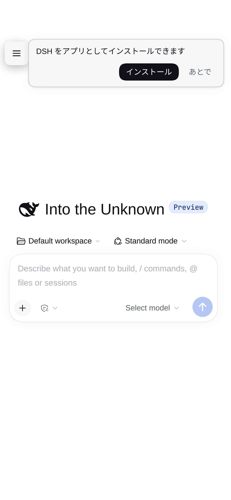

# Usage (English)

Everything `dsh-mobile-maxxing` does, in detail. **For installation see the [README](../README.md#install).**

日本語: [USAGE.ja.md](USAGE.ja.md)

## What this package is

Plugins that used to be separate, merged into one. The CJK autolink fix remains a
separate package because it rewrites the PC renderer.

| Was | Now |
| --- | --- |
| `rdsh-pwa` | PWA: installable, offline launch, notification send/receive, notification sounds |
| `rdsh-mobile-ux` | Phone-width UX: drawer, settings, composer, code view, in-app banners |
| `rdsh-markdown-cjk` (separate) | Fixes broken autolinks around CJK text; not mounted by this package |

**Why not separate packages:** DSH maps one package to one browser module. Splitting them
would register one module per package and scatter the install, the settings and the
enablement. The parts are independent, so merging them costs nothing. The CJK fix stays
separate because it changes the PC renderer.

## What it does

| Feature | Detail |
| --- | --- |
| Installable PWA | Manifest, service worker, offline page, update banner |
| Notifications | In-app banner while the app is on screen, Web Push otherwise |
| Notification sounds | Five synthesised presets, volume, no audio files |
| Mobile layout | Sidebar becomes a drawer, settings open in one tap, code wraps by default (toggle available) |
| CJK rendering (optional) | Only with the separate `rdsh-markdown-cjk` package; this package leaves the Markdown renderer stock to avoid changing the PC |

## Screenshots




### One Mobile settings tab

This package contributes only **Settings → Mobile**. It contains the per-device theme,
the device-local chat view, text/code/terminal sizes (including a terminal-only dark
palette), notification controls and sounds, Enter-key behavior, and
app installation/update/status.
There are no separate App or Input tabs. Hidden-control lists and browser-level overrides,
extra hide-label editing, basic UI status, screen-size diagnostics, and scroll diagnostics
have been removed. Standard mobile-only control hiding remains; old saved hide overrides
are no longer read. No browser data is deleted. PCs receive no settings from this package.

### Display, chat view and permission for this device only

Mobile also holds settings that affect this browser alone. Each one lives in `localStorage`;
none writes the shared DSH profile.

| Setting | Effect |
| --- | --- |
| Font sizes (text / code / terminal) | Changes this device's rendering only |
| Terminal-only dark | Keeps the terminal dark on a light page; the shared theme and the rest of the UI are unchanged |
| Display language | Changes this device's UI language; only locales registered in the shared locale service are offered. Japanese appears only with the optional separate `dsh-locale-ja` package |
| Default permission | Applies to new sessions started on this device only |

The permission choice is recorded as the session's own `/permission` right after it opens; the
Host `defaultPreset` is untouched. The composer stays disabled until that command settles, so
the first send already runs under the chosen permission.

### Chat view (this device only)

**Settings → Mobile → "Chat view (this device)"** overrides four General chat preferences
for this browser: work-details verbosity, when a completed turn collapses, what Enter does
while a turn runs (queue or steer), and performance detail. A choice is written into the
client's live view and kept in `localStorage`; the shared configuration form and the Host
settings are never written. A row you have not changed follows the Host setting; the
"Follow Host setting" button (shown when an override is set) drops the override and returns
to the latest value the Host accepted. If upstream does not expose an entry or hook, that
row is disabled and says why instead of looking saved.

### Theme (light / dark)

Every colour comes from the host's theme tokens (`--dsw-*`). The earlier version baked in
dark values, so on the light palette the selected session row, the popovers, the toast and
the settings buttons were barely readable. Both palettes are now honoured.

**Settings → Mobile → "Theme (this device only)"** picks a palette for this browser alone
(follow the shared setting / light / dark / match the device). The choice lives in
`localStorage` only: it never writes the DSH profile, so **changing it on a phone does not
reach the PC**. The shared theme stays in Settings → General → Appearance.

- If the upstream DOM contract (`body[data-ds-dark-theme]` / `html{color-scheme}`) has
  changed, the override is verified after it is applied and then **gives up, falling back to
  the shared theme** (the settings card says so).
- A registered palette (custom theme tokens) disables the override, since mixing the two
  token layers produces a page neither theme owns.
- The splash screen and task switcher colour come from the manifest's `themeColor`, which
  cannot be per-device; set `themeColor` / `backgroundColor` to `#fff` in the profile patch
  if you run light-only.
- One meta cannot switch the status bar between black and white glyphs, so the default is
  `black-translucent` again (white glyphs over a dark background), matching the previous
  layout. Set `appleStatusBarStyle: "default"` for dark glyphs on a light palette.
- The stored choice is applied when the theme service resolves, so a synchronous frame can
  briefly use the shared palette before the device palette takes over. This is observed on
  the first load and on a font-size change: the shared dark palette is written, then the
  device palette returns in a microtask. The palette read at rAF is the device one; a
  physical flash on a real device has not been verified.

### Terminal-only dark

**Settings → Mobile → Display → "Dark terminal only"** keeps the terminal dark while the
page stays light. The choice is browser-local (`localStorage`) and applies on a phone only.
It paints the terminal body and asks the terminal to reread that palette through the theme
service; the surrounding UI, the shared theme and the Host settings stay as they are, and
the terminal keeps its own ANSI palette with upstream's contrast floor. It is off by
default, and nothing is painted until the theme service is available.

### Language

`lang` defaults to `ja`. The host injects the normalized value into the index as
`globalThis.__RDSH_PWA_LANG__`; this package's browser half prefers it over
`document.lang` (the shell's `document.lang` is never rewritten). The manifest, the
service-worker offline page and the notification text follow the same value
(`notifications.lang` overrides it for notifications alone). `lang: "en"` makes the
browser half, the service worker, the manifest and notifications all English;
untranslated dictionary keys fall back to English.

This package does not add a `ja` language pack. The picker lists only the `en` /
`zh` locales the host registers, and a stored `ja` choice is ignored while no owner
registers it (nothing is guessed). Japanese requires the optional separate
`dsh-locale-ja` package, installed from its local tarball. It is not part of the
mobile tarball and is never enabled automatically. Both packages may be enabled
together without a duplicate registration (the mobile half never calls
`addLanguage`), and the shared display language is never rewritten: only this
device's view is projected. See
[`packages/dsh-locale-ja/README.md`](../../dsh-locale-ja/README.md) for its
translation status and install steps. The PC's language list is unchanged.

## Mobile layout

The mobile UI is selected by the **device mode**, not by the window width. A small
script injected by the host at the top of `<head>` decides it once in the browser and
writes `globalThis.__RDSH_DEVICE_MODE__` and, in mobile mode only,
`html[data-rdsh-device-mode]` (a desktop document carries no marker)
(`"mobile"` or `"desktop"`). The same HTML/JS is served to every device; there is no
SSR. Client code consumes the value; it never re-classifies from UA, width, pointer
kind or touch points.

Resolution order: a valid `__RDSH_DEVICE_MODE__`, then a valid
`data-rdsh-device-mode` attribute, then `"desktop"` (fail closed). A desktop
build is a hard no-op: no part is applied, so no DOM, style, listener or storage
is touched. If the two
disagree, the global wins and the root attribute is synchronised to it.

- Phones (iPhone/Android, portrait or landscape) and tablets (iPad, Android tablets)
  are mobile. iPadOS's desktop-like UA (Macintosh plus `maxTouchPoints`) is still a
  tablet.
- Ordinary PCs, **Windows touch laptops**, and narrow desktop windows are desktop.
  Touch alone never selects mobile.
- Crossing 767px changes geometry only. Resizing or rotating never changes the mode.
- A shell without the bootstrap loaded by a **new client** (for example an old cached
  shell opened offline) is desktop until the next online launch refreshes the HTML.
  An old bundle still carries the old width code, so not every old offline session is
  desktop.
- Detection has limits: an Android tablet that requests the desktop site may lose the
  Android token and be treated as desktop. It is not infallible.

The layout (sidebar becomes a drawer) uses the same mode. Width never selects the
mode, but the right panel has one size tier: at **768px and wider** it uses upstream's
dock layout, and below 768px it opens as the phone sheet. Docking is not guaranteed by
width alone: it needs the room left after the safe-area insets and the conversation's
minimum width and gutters, measured against upstream's minimum panel width (420px in the
rc.2 implementation). Measurements showed too little room at 1024–1119px and with large
insets, so the panel stayed a sheet. The existing <=380px composer compression is the only
other size tweak.

What changes:

- The sidebar becomes an overlay drawer you open with the floating button
- At 768px and wider the right panel uses the dock beside the conversation when the
  measured width allows it; otherwise it stays the full-screen sheet. Below 768px it is
  always the sheet. The panel's fullscreen control stays visible, so a fullscreened panel
  can always go back to the dock, and a rotation re-fits a docked panel to the new
  orientation. While the panel is docked, a swipe on the conversation is left to the
  conversation; only a swipe that starts on the panel closes it
- Settings get a single column and a scrolling tab strip
- The code viewer wraps by default; the header's wrap button turns that
  off and long lines scroll sideways again
- Code review opens with wrap on; a wrap you turn off stays off for that
  review tab for this page (upstream switches the diff from side-by-side to the unified
  layout while wrap is on, so both columns come back when you turn wrap off)
- Text-preview header actions (reload and file actions) move into a "…" menu
  that calls the original buttons; the path, the viewer picker and the wrap
  toggle stay in the header
- The native "Open in <app>" split button is not shown in mobile mode, because
  the mobile surface cannot hand the file to that desktop app
- The composer stays above the keyboard
- Session rows keep their actions hidden until the menu or a long press
- Right-panel tabs are finger-sized, and the tab strip scrolls sideways
- The phone sheet names the tab's kind above the tab strip: "Terminal" and "Subagent" by
  kind, and the tab's own label for every other kind ("Files", "Start", ...), in the display
  language. The heading never takes a tap
- Dragging inside the terminal scrolls it (the bundled xterm has no touch support)
- The terminal gets a top key row for Esc, Tab, arrows and Ctrl; it stays above the keyboard.
  Ctrl applies to the next key only: Ctrl then C sends ETX (0x03) to the PTY, which an
  ordinary shell treats as an interrupt (raw-mode apps may handle it differently), and
  tapping Ctrl again cancels it.
- Scrolling to the top of a conversation loads older messages automatically while history
  remains: after a real scroll settles at the top, the existing load-earlier control is
  pressed once. A new send that scrolls to the bottom, or any programmatic scroll, does not
  trigger it
- On a phone the Trajectory conversation tab stays reachable: upstream folds tabs that do not
  fit into the header "…" menu, so the view is a tab where the row has room and the first menu
  row where it does not
- The workspace file search has a clear button; clearing the field also resets the filter,
  the highlight and the "no matches" state
- The model picker menu is kept inside the left and right safe area of the visible viewport
  (notch included); only when that band is narrower than the menu is its width capped

The long press opens the same menu as the `...` button. Swipe right on an open drawer to
close it; swipe left to open it. On a plugin detail (including nested levels) or an
automation task detail whose list is hidden, a left-edge swipe presses that screen's own
back control instead of opening the drawer, so one swipe goes back one level. The
Automation route starts below the floating drawer button, so scrolled rows are not covered
by it.

## Notifications

### Which channel

| App state | How you are told |
| --- | --- |
| Visible (foreground) | In-app banner; no system push if the host receives its acknowledgement |
| Background, another app, closed | Web Push system notification |
| Tap the notification | That session opens (banner "open" while in the app) |

The host waits up to 1.5s per notification event for an acknowledgement. A visible
page renders the local banner from session state and acknowledges that event for its
own push endpoint only after React has committed the banner, so a banner that was
replaced before it appeared acknowledges nothing. Only acknowledged endpoints skip
push. A hidden, disconnected, or failed page sends no acknowledgement, so ordinary Web
Push is the fallback; there is no visibility heartbeat or expiring lease. Every push
that reaches the service worker calls `showNotification`, as WebKit requires.

An acknowledgement is **per subscription (endpoint)**. A reinstall or a browser-side
rotation creates a new registration while the old endpoint, still delivered to the same
device, becomes unreachable from the page. A leftover endpoint therefore turns one
foreground event into a banner plus a system notification (#98). Two steps retire it:

- on subscribe, the page sends the endpoint it held last (kept in `localStorage` as
  `rdsh-mobile-ux:push-endpoint`) as `previousEndpoint`, and **only that one entry of
  the same origin** is removed
- launch, reconnect, and return to a visible app re-register the current subscription. If an explicitly
  enabled subscription disappears it is recreated; only a 404/410 from the push service removes an entry

An origin is shared by every device, so the store never collapses it to "the newest
endpoint". Another origin always keeps its subscription, and another device on the same
origin is only removed by its own named endpoint. User-Agent and age heuristics never
remove a healthy device. Automatic recovery requires an explicit opt-in; a disabled or
never-enabled browser is not subscribed automatically.

**Settings → Mobile → Test** follows the same rule: while the app is visible it only
shows the in-app banner, and the host's `/push/test` (a real Web Push) is used only when
the page is backgrounded — that route was the remaining way to get a system notification
while the app was open.

The turn-end banner follows the host's own rule. While `onlyMobileTurns` is on (the
default) only a session this browser sent in raises one, because that is the only turn
the host notifies. Questions are always announced in the app, whichever device started
the work.

An acknowledgement that arrives too late still leaves the system notification beside
the in-app banner, and a push already sent cannot be taken back, so that duplicate is
accepted. A commit proves the banner was mounted, not that the user read it: another
notice can replace it immediately.

### Sounds

The banner plays a sound. **No audio files ship with the package**: each preset is
synthesised with Web Audio.

| Preset | Sound |
| --- | --- |
| `chime` | Two rising notes (turn finished) |
| `pop` | One short note (question) |
| `drop` | Three descending notes |
| `tick` | Short double tap |
| `none` | Silent |

Volume is 0–100% and both choices are stored in `localStorage`.

### Copy and behaviour

```yaml
- id: dsh-mobile-maxxing
  config:
    notifications:
      appName: "DSH"
      turnEndTitle: "{session}"
      turnEndBody: "{detail}"
      questionTitle: "{session}"
      questionBody: "{question}"
      onlyMobileTurns: true   # only turns sent from this phone
      subject: ""             # VAPID contact; "" means the app's own origin
```

With the `onlyMobileTurns: true` default a desktop send is never notified. The
switch lives in **Settings → Mobile** of a browser that runs the mobile UI; a PC
never shows it because the plugin applies nothing there. It does not write the
host config: it marks the browser's own sends as phone sends, so the choice is per
browser (`localStorage`). Set `onlyMobileTurns: false` in the profile to notify
every device instead.

Placeholders: `{app}` `{session}` everywhere; `{status}` `{detail}` `{reason}` for a
turn end; `{header}` `{question}` `{count}` for a question. An unknown placeholder stays
verbatim, so a typo is visible instead of silently dropped.

### How it works

Web Push is implemented directly on `node:crypto`; no push library is involved.

- **VAPID (RFC 8292)** — an ES256 JWT in the `Authorization` header, signed with
  `ieee-p1363` (`r||s`, not DER)
- **Encryption (RFC 8291 / 8188)** — ECDH → HKDF → AES-128-GCM, including the `aes128gcm`
  record framing

Keys and subscriptions live in `~/.dsh/dsh-mobile-maxxing/push.json` (mode `0600`). The VAPID `sub`
is resolved from `config.notifications.subject`, then the `https` origin of the newest
subscription, then `mailto:dsh@example.com` — Apple rejects `mailto:root@localhost` with
`403 BadJwtToken`.

Delivery is scoped per origin. An event that carries an origin (a phone-started turn, a test
push) goes to that app's subscription only; otherwise the newest origin this host has learned
that still has a subscription is used. When no origin is known the push is dropped and logged
as `push skipped: no app origin has talked to this host yet` instead of being sent to every
stored subscription, which would notify both installed apps for one event. Learned public origins
with subscriptions are persisted per profile and restored only into that same profile after a
restart; another profile cannot inherit them. A subscription answered with 404/410 is removed
from the store on the spot.

So that one device does not accumulate endpoints, `/push/subscribe` accepts
`previousEndpoint` (the endpoint that browser held last) and removes that one entry of
the same origin. No User-Agent or timestamp heuristic removes another device's subscription.

Delivery validates the endpoint again. Only HTTPS without embedded credentials is accepted;
every DNS answer must be public, and the socket uses the same validated addresses. Redirects
are not followed. Each device is contacted concurrently with a 10-second deadline, so one
slow endpoint cannot hold back the others.

### Relation to the old plugin

This package does not share an API or a service worker with `dsh-notify-push`. Its routes
are `/api/dsh-mobile-maxxing/push/…`. If both are installed the service-worker registration would
collide, so this package redirects a `/push/sw.js` registration to its own `/sw.js` (the
wrap touches nothing else and is removed on dispose).

## Dependencies

**This package alone is enough for the core.** No other `rdsh-*` plugin, no external npm
package. The CJK fix is the optional separate `rdsh-markdown-cjk` package.

| Dependency | Required | Detail |
| --- | --- | --- |
| DSH itself (`@deepseek-ai/dsh-*`) | yes | Sidebar, settings, model picker, goal, todo, jobs. Upstream class names are CSS-module hashes, so this plugin attaches `data-rdsh-*` hooks from **structure** (`data-row-key` / `aria-label` / `role`) and its CSS only looks at the hooks. If upstream changes, the hooks are not attached and the stock layout stays (fail closed) |
| Notifications | bundled | Web Push implemented on `node:crypto`, so no `web-push` and no separate plugin |
| `react` / `react-dom/client` / `@deepseek-ai/dsh-client-ui-primitives` | provided by DSH | All shipped with DSH; nothing to install |

The browser half reads only its own globals (`__RDSH_PWA__`, `__RDSH_PWA_SETTINGS_SECTION__`,
`__RDSH_MOBILE_UX__`, `__RDSH_PWA_LANG__`), each behind a `typeof` check.

## Migrating from the split plugins

When moving from the old `rdsh-pwa` + `rdsh-mobile-ux` pair, translate the profile patch
as follows. **This package never edits the profile.**

- Move `rdsh-mobile-ux`'s `runningAnimation` / `hideLabels` / `showHiddenControls` to
  `dsh-mobile-maxxing.mobileUx.*`
- Remove the old plugins from the profile: `rdsh-mobile-ux`,
  `rdsh-session-id-copy`, `dsh-notify-push`. Also remove `rdsh-mobile-ui` (layout) and
  `@local/dsh-sound` (sounds) if present, or the layout and the notification sound are
  controlled twice
- The CJK fix is not part of this package. Keep `rdsh-markdown-cjk` only if you want it
- Keep one `dsh-mobile-maxxing` entry. Put `lang` (default `ja`) and `appleStatusBarStyle` in its
  config

Leaving the duplicates installed duplicates routes, slots and notifications.

## Verification

```sh
npm test                    # Node.js unit tests, no browser needed
npm run e2e                 # real-browser end-to-end (optional)
node scripts/pack-all.mjs   # build the release tarballs into dist/
```

`npm test` runs without DSH installed; cases that need the installed DSH frontend report a
skip. Set `DSH_ORIG_BIN` (as the systemd unit does) to run them.

The browser half is covered by static checks in
`packages/dsh-mobile-maxxing/tests/client-integrity.test.mjs` (undeclared call targets,
listener definitions, dead `data-rdsh-*` attributes) and a smoke test in
`packages/dsh-mobile-maxxing/tests/client-load.test.mjs` that evaluates the module against a
stub environment.

## How it fits together

- The host half serves `/manifest.webmanifest`, `/sw.js` and `/api/dsh-mobile-maxxing/push/…`, and
  adds the PWA metadata to the served index
- The browser half is loaded verbatim by the client module loader; it installs the layout,
  registers the service worker and renders the banners
- Nothing is patched on disk. The CJK fix is a separate plugin; this package leaves the PC
  renderer stock

## Icons

`assets/` holds the maskable and regular icons plus the badge. The manifest points at
`/pwa/…`, which the host half serves from the package — the installed DSH is never touched.

## Known limits

- The layout depends on upstream CSS-module hashes existing. A rename only stops a rule
  from matching and leaves the stock layout (fail closed), but a renamed hook means the
  mobile layout is simply absent until this package is updated
- Notifications need a secure context. Over plain HTTP on a LAN address the browser will
  not offer a subscription
- The service worker manages one scope. Another plugin registering a worker at `/` will
  fight over it
- The per-device theme is per **browser**, not per hardware device (another browser on the
  same phone is separate, and clearing site data returns it to "follow the shared theme")
- The offline page cannot read the stored theme (a service worker has no `localStorage`
  access), so it follows the OS light/dark preference
- With two current hosts, one `DSH_HOME` means one push store at
  `DSH_HOME/dsh-mobile-maxxing/push.json`. The pre-rename `DSH-PWA` host uses
  `DSH_HOME/rdsh-pwa/push.json`, so after the rename the same `DSH_HOME` is no
  longer the same file. Sharing that file with the old writer is still unsafe:
  it does not reload before saving and can erase a subscription. Subscriptions
  left in the old namespace are not migrated automatically, so re-subscribe if
  needed; see [the two-app host prerequisite](ios-manual-acceptance.md).

## The iOS 26 bottom strip (47px / 62px)

On iOS 26 the web view can be shorter than the screen: `screen.height - innerHeight` is
about 47px. The home indicator lives in that strip, outside the page, so the inner bottom
safe-area padding only makes the blank area larger.

The package detects this (`data-rdsh-native-gap`) and sets the inner bottom padding to 0
for the sidebar, the right panel and settings. This was previously done with a `/launch`
route that stripped the PWA tags for comparison; that route is gone — an unauthenticated
diagnostic page does not belong in a shipped package.

## The iOS 27 top-edge blur

An iOS 27 home-screen PWA lays a progressive blur over the top edge unless a
`position: fixed` element sits there. In a standalone iOS (WebKit) app the package mounts one
11px fixed element at the top (`.dsh-mobile-maxxing-top-edge`). It declares the canvas colour
as `background-color` and paints nothing, because `background-clip: text` has no text to clip
to. WebKit reads the colour from the computed style, not from painted pixels, so the check
passes without a visible change ([reference](https://qiita.com/na-trium-144/items/0add98a80ca2391e3f17)).
Hiding it with `opacity: 0`, `visibility: hidden` or `display: none` drops it from the check
and the blur comes back. In a Safari tab the same element turns the toolbar opaque, so it is
off outside standalone.

WebKit only uses the element when the host app obscures the top edge
([an article that traces the WebKit source](https://zenn.dev/uakihir0/articles/260920-ios27-pwa-blur)).
On an iPhone (2026-10-26, iOS 27.2):

- With the default `appleStatusBarStyle: "black-translucent"` the page draws under the clock
  and the blur stays, element or not.
- With `appleStatusBarStyle: "default"` in the profile patch, after deleting the home-screen
  icon and adding it again, the page starts below the clock, the element's colour fills the
  status bar strip, and the blur is gone.
- Changing the setting alone does not affect an icon that is already installed; it keeps the
  style it was added with. Re-adding the icon drops that app's push subscription and its
  device-local settings (localStorage).
- With the final, unpainted element the strip took the background colour and there was no
  blur, in both light and dark mode. The status bar text is black in light mode and white in
  dark mode. iOS 26 under `"default"` is unverified.

Under `"default"` the page starts below the status bar, so the height it lacks is the status
bar itself. Treating that as the unpainted bottom strip (`data-rdsh-native-gap`) would put the
composer under the home indicator, so that check only runs under `black-translucent`.

## Credits

The package is written by referencing the implementations below. **No code was copied**
(notifications are implemented from the RFCs, the UI attaches hooks from DSH's own
structure). **None of them is a dependency** — this package works on its own.

| Source | What was referenced |
| --- | --- |
| [`dsh-notify-push`](https://github.com/hikarioyama/Smart-DSH) (MIT, © hikarioyama) | The overall notification design: using the origin as the VAPID `sub`, firing on `session/event` `turn/end` and on `user-questions/request`, the re-entrancy guard and re-assert when selecting a session with `openSession`, the `postMessage` path for a notification tap |
| [`dsh-sound-notifications`](https://github.com/cwd514/dsh-sound-notifications) (MIT, © cwd514) | The idea of per-event sounds and of a foreground check like `onlyWhenHidden` |
| **[`rdsh-mobile-ui`](https://github.com/jimoto-no-llm/rustdsh)** (MIT; ported by lasder-ca; original by hikarioyama of [Smart-DSH](https://github.com/hikarioyama/Smart-DSH)) | The phone-width approach and the specific declarations that made it work: pinning the grid columns when collapsed (`centerCol: 2` / `rightbarCol: 3`), the 64px header inset that clears the drawer button, and sizing the chat from its column instead of pixel floors (`--dsh-chat-user-width` / `--dsh-chat-content-width` / `--dsh-composer-card-max-width` set to 100%). This package re-expresses all three against its own `data-rdsh-*` hooks so it works without that plugin |
| [`web-push`](https://github.com/web-push-libs/web-push) (MIT) | Confirming the reading of RFC 8291/8292 (implementation is our own) |
| DSH itself (`@deepseek-ai/dsh-*`) | The toast primitive (`primitives.Toast`) and the `uiWorkspace` / `sessions` / `agents` / `webServer` services |
